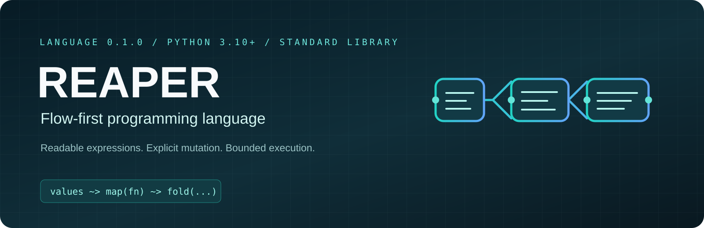

[English](README.md) · [Українська](README.uk.md) · [Русский](README.ru.md) · [简体中文](README.zh-CN.md)

<h1 align="center"><strong>⚙️ Reaper — Systems Language & Workbench</strong></h1>

  

> **Explicit contracts. Typed flows. Diagnostics with source provenance.**

**State:** Alpha · reference runtime available · native C17 partial · **Version:** Python package 0.1.0 · Native CMake track 0.2.0 · **License:** [Apache-2.0](LICENSE) · **README standard:** Psychoporter 666 v1.0 · **Last reviewed:** 2026-11-25 · UTC · **Source:** [Ivan-VHS/Reaper](https://github.com/Ivan-VHS/Reaper)

## Quick navigation

[🚀 Demo: Studio screenshot](assets/screenshots/reaper-studio.png) · [Documentation](docs/README.md) · [Source repository](https://github.com/Ivan-VHS/Reaper) · [Issues](https://github.com/Ivan-VHS/Reaper/issues)

## Mission & scope

Reaper is a systems-programming language and local development workbench. The Python reference runtime, CLI/REPL, LSP/DAP services and Windows Studio foundation are distinct from the experimental native C17 compiler track. Native parity and privileged hardware services are not complete.

## Capabilities

- .rpr source language, lexer/parser, reference interpreter and structured diagnostics.
- CLI, REPL, Windows Studio foundation, and stdio-based LSP/DAP services.
- Static checks and resource quotas in the reference runtime; check-only mode does not execute source.
- Native C17 track: lexer, parser, owned AST, checked IR, constant folding and limited lowering.
- Checked MMIO descriptors and ABI contracts are interfaces, not a physical device mapper or driver.
- Jora scaffolding, Kora helpers and optional peer integrations with explicit trust boundaries.

## Architecture & data flow

~~~mermaid
flowchart TB
  S[".rpr source"] --> P["Lexer / parser"]
  P --> V["Reference runtime"]
  V --> C["CLI / REPL"]
  V --> L["stdio LSP / DAP"]
  S --> N["Native C17 track — partial"]
  N --> I["Checked IR / limited lowering"]
  H["Hardware contracts"] --> A["Checked ABI descriptors"]
  A -.-> X["No implicit device access"]
~~~

Source code, schemas, build files, tests and CI are the evidence for implemented behavior. Roadmap entries and catalogue records describe plans or inventories, not shipped functionality.

## Requirements

Python 3.10+ for the reference runtime and package tools; CMake 3.16+ plus a C17 compiler for the native track; Node.js 22/24 for optional compatibility checks; Tkinter for the Windows Studio GUI.

## Build

~~~sh
python -m venv .venv
. .venv/bin/activate
python -m pip install -e .
python -m reaper --check examples/flow.rpr
python -m reaper examples/flow.rpr
~~~

### Native C17 track

~~~sh
cmake -S . -B build -DREAPER_BUILD_TESTS=ON
cmake --build build --parallel
ctest --test-dir build --output-on-failure
~~~

The Python reference runtime and native C17 track are separate implementation tracks; passing tests in one does not establish feature parity in the other.

## First checks

~~~sh
python -m reaper --check examples/flow.rpr
python -m reaper --repl
~~~

The --check command performs static validation before execution. On Windows PowerShell, activate with .venv\Scripts\Activate.ps1.

## Run

After installation, the package exposes the reaper-studio GUI script when Tkinter is installed; language and debug services are separate stdio processes.

## Interfaces

| Surface | Contract / entry point | Boundary |
|---|---|---|
| CLI / REPL | `reaper` | Source checking, execution and interactive mode. |
| Language service | `reaper-lsp / stdio` | Document-local diagnostics, completion and navigation subset. |
| Debug adapter | `reaper-dap / stdio` | Implemented breakpoint and step subset. |
| Native ABI | `reaper_ffi / reaper_system / reaper_dabi64_desktop` | Versioned C interfaces; native compiler parity remains partial. |

REST/GraphQL, WebSocket, OAuth, cloud deployment and cookie mechanisms are not advertised without a versioned implementation and tests.

## Security & trust boundaries

The reference runtime applies bounded resource controls and explicit capability contracts. MMIO APIs validate descriptors and access policy but do not map physical devices. LSP/DAP use local stdio transports; a hosted REST service, OAuth provider or cloud control plane is not part of the documented runtime.

Security reporting: [SECURITY.md](SECURITY.md). Do not publish secrets, device identifiers or private logs in public issues.

## Verification

~~~sh
python -m unittest discover -s tests -v

cmake -S . -B build -DREAPER_BUILD_TESTS=ON
cmake --build build --parallel
ctest --test-dir build --output-on-failure
~~~

The checked-in CTest/unittest targets and workflows define the test scope. No coverage percentage, fuzz result or load-test report is claimed without a published artifact.

## Performance evidence

No stable cross-machine latency or memory-footprint claim is published for the reference runtime or partial native track. Compare reproducible runs with compiler, target, build mode and input recorded.

## Compatibility

The reference package supports Python 3.10+; the native C17 track uses CMake and a host C17 compiler. Windows Studio requires Tkinter. Platform and compiler parity must be checked per target.

## Documentation & ecosystem

- [Features and maturity](docs/FEATURES.md)
- [Architecture](docs/ARCHITECTURE.md)
- [Hardware language](docs/HARDWARE_LANGUAGE.md)
- [Implementation roadmap](docs/IMPLEMENTATION_ROADMAP.md)
- [Studio and IDE](docs/REAPER_IDE.md)
- [Psychoporter 666](docs/PSYCHOPORTER_666.md)
- [Documentation index](docs/README.md)

The feature matrix and implementation roadmap separate reference-runtime behavior from partial native work and future hardware capabilities.

Cross-project integrations use documented versioned interfaces and explicit adapters. An optional adapter does not grant another project runtime or hardware privileges.

## Contributing

Read CONTRIBUTING.md before changing code or contracts. Keep changes reviewable, add deterministic tests and use Conventional Commits where required by the repository guide.

## License & legal

Distributed under [Apache-2.0](LICENSE). The software is provided “AS IS” under the license terms. Third-party project names and trademarks remain with their respective owners.

This repository documents local software interfaces. Hosted-service terms, cookie consent, OAuth and CORS are not applicable to the runtime surfaces described above unless a separate hosted component is introduced and documented.

---

Psychoporter 666 README Standard v1.0 · Ivan-VHS · 2026-11-25 · UTC

