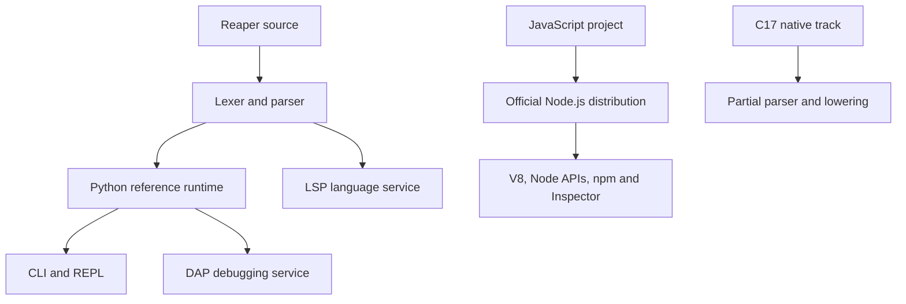
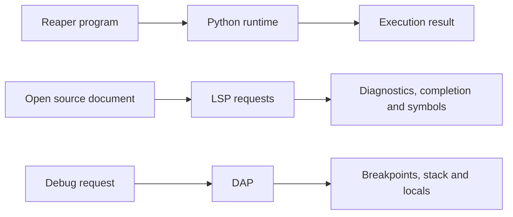

# Reaper — flow-first programming language

[English](README.md) · [Українська](README.uk.md) · [Русский](README.ru.md) · [简体中文](README.zh-CN.md)

[CI](https://github.com/Ivan-VHS/Reaper/actions/workflows/ci.yml) · [Windows Studio build](https://github.com/Ivan-VHS/Reaper/actions/workflows/desktop-build.yml) · Python 3.10+ reference runtime · C17 native track · Windows Studio · Apache-2.0
**Developer:** [Ivan-VHS](https://github.com/Ivan-VHS)

Reaper is an expression-oriented language: `::` passes a value into the next operation. The Python runtime is the current executable compatibility reference. The C17 implementation is an active native track, not yet a complete replacement.

## Live Reaper Studio

<p align="center"></p>

## Functional data flow

The diagram summarizes implemented data movement between the project's input sources, processing stages and generated outputs.



## Runtime and output paths

This second view separates execution paths and supported outputs from catalogue-only or unavailable behavior.



<sub>Actual application capture · 1920×1080 source image · original pixels retained; no artificial upscaling.</sub>

## Current capability matrix

| Area | Implemented scope and boundary |
|---|---|
| Python runtime | lexer, parser, interpreter, CLI, REPL, modules, closures, quotas and audit |
| Reaper Studio | Windows IDE foundation: project tree, editor, syntax coloring, line numbers, search, check/run and debugger |
| LSP | stdio service with incremental UTF-16 documents, parser/structure diagnostics, completion, hover, symbols and lexical navigation; per-open-file, not cross-file type inference |
| DAP | stdio debug adapter with launch, line breakpoints, statement stepping, stack and local variables |
| Division and allocation | checked Euclidean division, balanced work partitioning and proportional allocation |
| Atomic-Quantum 133 | 133 operation IDs; 8 reviewed deterministic classical simulation kernels; remaining entries catalogue-only | bounded ≤10-qubit state-vector model; no quantum-hardware access |
| NOO TAH | official Node.js integration: V8/libuv, ESM/CommonJS, core APIs, streams, workers, npm/npx, N-API and Inspector; Studio JS Run/Check/Debug/Stop and npm commands |
| Internal plugin host | 18 built-in services with lifecycle state and bounded dispatch; Python reference runtime |
| Kora | 66 standard utility functions in seven manifest-backed modules; three Lua ReaScripts for Cockos REAPER |
| Native C17 | lexer, expression parser, owned AST, checked IR and limited lowering; not full Python-runtime parity |
| МОСТ | 54 exact aliases: 21 executable in the current reference subset, 33 lexically reserved |
| QCS 1.0 | separate hardware-domain parser and JSON AST; no hardware execution |
| THESIS | typed evidence graph; claims are not automatically verified |
| Registries | 813 feature proposals, 666 API contracts and 666 reserved token lexemes; registry entries are not completion claims |
| Federation | OPlague snapshots, VentuSample pack manifests and optional Pytyliki C ABI |

## CODEX-66 IDE workspace

Reaper Studio includes a native **CODEX-66** capability browser with six groups of eleven entries, searchable by feature ID, name, category and maturity. Use **Ctrl+Space** for local REAPER completion, **F12** for a current-document definition, **Find references** for lexical occurrences and **Ctrl+Shift+R** for current-document rename. **Ctrl+K** opens the command palette.

The catalogue labels each item as implemented, partial, planned or unsupported. Local completion is based on the canonical language service; it is not cloud AI. Rename and references are document-local, and the interpreter is not an OS sandbox. See [CODEX-66 implementation and boundaries](docs/CODEX_66_SHOWCASE.md).

## REAPER language and debug services

The editor/tooling layer exposes stdio protocol services:

```sh
python -m reaper lsp
python -m reaper dap
```

Installed entry points are `reaper-lsp` and `reaper-dap`. LSP provides incremental, per-document language features. DAP provides runtime debugging of Reaper programs. These services use the canonical Python parser/runtime; they do not imply complete native C17 parity, project-wide semantic analysis or a packaged VS Code extension client.

See [REAPER IDE architecture](docs/REAPER_IDE.md) for precise capability limits.

## NOO TAH — Node.js runtime

NOO TAH manages the official cross-platform Node.js runtime instead of imitating its engine. V8, libuv, core modules, ESM/CommonJS, streams, workers, child processes, npm/npx, N-API and Inspector are supplied by the selected Node distribution.

Reaper Studio recognizes `.js`, `.mjs` and `.cjs` projects and provides JS Run, JS Check, JS Debug (Node Inspector), JS Stop, npm commands and runtime diagnostics. Node Inspector is not yet translated into the native DAP debugger panes.

```sh
reaper-noo-tah version
reaper-noo-tah doctor
reaper-noo-tah run app.mjs
reaper-noo-tah check app.js
reaper-noo-tah npm run build
node --test tests/noo_tah/conformance.test.mjs
```

The current conformance suite covers runtime metadata, ESM/CommonJS, filesystem I/O, crypto, streams/backpressure, loopback HTTP/TCP, workers, child processes, DNS and event-loop ordering. Its GitHub Actions matrix targets Node 22 and 24 on Windows, Linux and macOS. See [NOO TAH architecture](docs/NOO_TAH.md).

## Kora and Cockos REAPER applications

Kora contains 66 standard-library utility functions across ZDORO, DILLY, BAPLAP, KALI, PYEMONT, LIUR and SRETUO. The repository also ships three Lua ReaScripts:

- **Track Health Dashboard** — read-only project and track diagnostics.
- **Prefix Selected Tracks** — selected-track renaming in one undoable operation.
- **Marker and Region Report** — marker/region index in the ReaScript console.

In Cockos REAPER open **Actions → Show action list → ReaScript → Load** and select a script from `reaper_scripts/kora/`. These are scripts hosted by REAPER, not compiled VST/AU/CLAP effects. No Node.js process is required to run them. See [Kora for REAPER](docs/KORA_REAPER.md).

## Atomic-Quantum 133

The Python reference runtime exposes 133 stable operation IDs in six families: state, entanglement, measurement, noise/ECC, atomic dynamics and algorithms/telemetry. Eight reviewed kernels currently provide bounded, deterministic classical simulation; the remaining catalogue entries are explicitly **catalogued-only**, not claimed as implemented. The state-vector model is limited to 10 qubits, validates finite amplitudes and normalization, and supports seeded measurements. It does not discover, calibrate or control quantum hardware, and the C17 track is not quantum-hardware execution. See the [Atomic-Quantum 133 contract](docs/ATOMIC_QUANTUM_133.md).

## Run, test and build

```sh
python -m reaper examples/flow.rpr
python -m reaper --check examples/flow.rpr
python -m reaper --engine vm examples/flow.rpr
python -m reaper --repl
python -m unittest discover -s tests -v
```

Launch the Windows Studio with `python reaper_desktop.py`.

Build the native C17 track:

```sh
cmake -S . -B build -DCMAKE_BUILD_TYPE=Release
cmake --build build --parallel
ctest --test-dir build --output-on-failure
```

Example:

```reaper
craft double(value) { yield value * 2 }
make result := [1, 2, 3] :: map(double) :: sum()
emit "result = " ++ text(result)
```

[IDE 666 contract](docs/IDE_666_IMPLEMENTATION.md) · [LSP/DAP](docs/REAPER_IDE.md) · [Node.js integration](docs/NOO_TAH.md) · [Kora for REAPER](docs/KORA_REAPER.md) · [Plugin host](docs/PLUGINS.md) · [Internal products](docs/INTERNAL_PRODUCTS.md) · [Features](docs/FEATURES.md) · [Language](LANGUAGE.md) · [Division](docs/DIVISION_ENGINE.md) · [Architecture](docs/ARCHITECTURE.md) · [813 registry](docs/REAPER_813_FEATURE_ARCHITECTURE.md) · [Federation](docs/PROJECT_FEDERATION_MATRIX.md) · [Docs index](docs/README.md)

[Українська](README.uk.md) · [Русский](README.ru.md) · [简体中文](README.zh-CN.md) · [Releases](https://github.com/Ivan-VHS/Reaper/releases) · [Apache-2.0](LICENSE)


## Bounded resource-allocation reference
An illustrative 500 UAH budget model with a versioned JSON contract and an offline simulator. This is a documentation example, not a feature of the host runtime.

[Multilingual guide](docs/RESOURCE_ALLOCATION_500_UAH.md) · [Interactive simulator](docs/resource-allocation-500-uah.html) · [JSON example](examples/resource-allocation-500-uah.json) · [JSON Schema](schemas/resource-allocation.v1.schema.json)

## CLife — code recovery and lifecycle

[CLife guide](docs/CLIFE.md) · Savepoints, integrity verification, targeted restitching and safe source revival.
