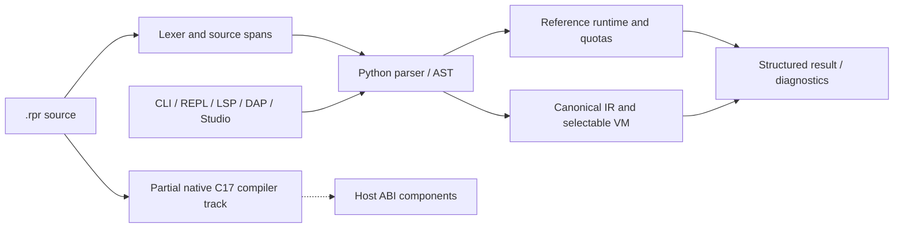

# Reaper — flow-first systems programming language

[English](README.md) · [Українська](README.uk.md) · [Русский](README.ru.md) · [简体中文](README.zh-CN.md)

> A flow-first `.rpr` language, reference runtime and developing native C17 compiler/toolchain for bounded systems and hardware-adjacent programming.

**Specification**

| Field | Current record |
|---|---|
| Repository | [Ivan-VHS/Reaper](https://github.com/Ivan-VHS/Reaper) |
| Product status | Alpha / active development; multiple implementation tracks |
| Product version | No single unified release version declared |
| Python package | `reaper-lang 0.1.0`, Python 3.10+ |
| Native track | C17 / CMake 3.16+; partial compiler and host ABI components |
| Runtime platforms | Windows, Linux, macOS (reference runtime) |
| Desktop platform | Windows Studio |
| License | [Apache-2.0](LICENSE) |
| Code of Conduct | Not published (no root `CODE_OF_CONDUCT.md`) |
| Last documentation review | 2026-11-26 |

<picture><source media="(prefers-color-scheme: dark)" srcset="assets/readme/dashboard.svg"></picture>

## Contents

- [Purpose and scope](#purpose-and-scope)
- [Architecture](#architecture-and-execution-flow)
- [Quick start](#quick-start)
- [Native C17 track](#native-c17-track)
- [Interfaces and ecosystem](#interfaces-and-ecosystem)
- [Limitations and security boundaries](#limitations-and-security-boundaries)
- [Documentation and contribution](#documentation-and-contribution)
- [Versioning and history](#versioning-and-history)

## Purpose and scope

Reaper is a flow-first programming language and developer toolchain for explicit data flow, bounded execution, structured diagnostics and systems-oriented experiments. The current compatibility implementation is a Python reference runtime; a separate C17 track implements native compiler and ABI components but is not yet feature-equivalent.

The language uses `::` for value-oriented composition. Files use the `.rpr` extension. Effects such as filesystem, process, network, clock, shell and native-library access must remain explicit or opt-in rather than implicit behavior of ordinary expressions.

## Architecture and execution flow



The reference runtime is the compatibility authority for implemented language behavior. The native C17 track is a separate maturity line and must pass conformance tests before it can replace reference behavior. Studio is a Windows desktop application; language and CLI tooling are not limited to Studio.

## Quick start

Requirements: Python 3.10+; Git is recommended. Install the editable package:

```sh
python -m venv .venv
python -m pip install -e .
python -m reaper --check examples/flow.rpr
python -m reaper examples/flow.rpr
```

Start the REPL or Studio:

```sh
python -m reaper --repl
python reaper_desktop.py
```

Run the reference-runtime tests:

```sh
python -m unittest discover -s tests -v
```

The CLI help and the [runtime platform reference](docs/RUNTIME_PLATFORM.md) define command options and limits.

## Native C17 track

Requirements: CMake 3.16+ and a C17 compiler.

```sh
cmake -S . -B build -DCMAKE_BUILD_TYPE=Release -DREAPER_BUILD_TESTS=ON
cmake --build build --parallel
ctest --test-dir build --output-on-failure
```

The native track includes lexer/parser, Canonical IR, optimizer/lowering and tested ABI/tooling components. It remains a partial compiler implementation; do not infer complete language support, general-purpose machine-code generation or freestanding kernel compilation.

## Interfaces and ecosystem

| Interface | Direction / use | Boundary |
|---|---|---|
| Pytyliki C ABI v1 | Optional native metric calls | Explicit trusted library path; in-process native code |
| OPlague device snapshot v1 | Read-only JSON import and comparison | Snapshot is evidence, not certification |
| VentuSample pack v1/v2 | File-based metadata inspection | Manifest metadata; WAV assets are not modified |
| DAK integration | Policy and contract relationship | Host/reference contracts do not imply kernel integration |

See [Federated Integration](docs/FEDERATED_INTEGRATION.md), [System Runtime ABI v1](docs/SYSTEM_RUNTIME_ABI_V1.md) and the [NEXUS federation profile](docs/NEXUS_FEDERATION_PROFILE_V1.md). Peer projects retain independent release cycles and licenses.

## Limitations and security boundaries

> Execution quotas are resource limits, not a security sandbox for arbitrary untrusted programs.

The Python reference runtime remains the compatibility default. Native C17 is partial; self-hosting covers a tested frontend subset, not a complete self-hosted compiler. Static type analysis is conservative and leaves unknown host/module values unresolved. The MMIO C API validates descriptors and capabilities through a host-supplied adapter; it does not map physical memory or operate hardware by itself.

Native FFI executes trusted native code in-process. Only explicitly selected ABI-compatible libraries should be loaded. Filesystem, process, network, clock and shell effects are separate capability boundaries. Hardware/embedded documentation includes reference and simulation surfaces; it must not be interpreted as firmware flashing or live hardware debugging.

The current package version and CMake project version describe separate artifacts. No single unified Reaper product release is declared.

## Documentation and contribution

Start with [Documentation Index](docs/README.md) and [Information Architecture](docs/INFORMATION_ARCHITECTURE.md).

- [Feature matrix](docs/FEATURES.md)
- [Architecture](docs/ARCHITECTURE.md)
- [Architecture foundation: 66 concepts](docs/REAPER_ARCHITECTURE_FOUNDATION_66.md)
- [Runtime platform and quotas](docs/RUNTIME_PLATFORM.md)
- [Native compiler](docs/NATIVE_COMPILER.md)
- [Hardware language](docs/HARDWARE_LANGUAGE.md)
- [Studio and IDE](docs/REAPER_IDE.md)
- [Diagnostics](docs/errors/DIAGNOSTICS.md)
- [Shared documentation standard](docs/UNIFIED_DOCUMENTATION_STANDARD.md)

Read [CONTRIBUTING.md](CONTRIBUTING.md) before changing syntax, runtime behavior or public contracts. Security reports follow [SECURITY.md](SECURITY.md). The project is licensed under [Apache-2.0](LICENSE); retain third-party attribution and notices.

## Versioning and history

The Python distribution currently declares `0.1.0`; the native CMake project declares `0.2.0`. These version fields apply to different deliverables and are not a unified language release number. The project remains in alpha development. Release history and compatibility transitions should be linked to actual Git tags, release artifacts and migration documents; do not infer stable API status from package metadata.
