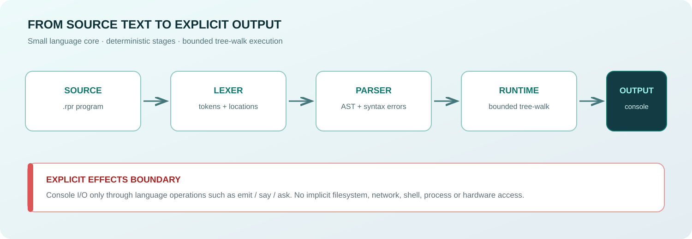

# Reaper — a flow-first programming language

<p align="center">
  
  
  
  
  <a href="https://github.com/Ivan-VHS/Reaper/actions/workflows/ci.yml"></a>
</p>

<p align="center"><strong>WRITE CLEARLY. COMPOSE FLOWS. MAKE EFFECTS EXPLICIT.</strong></p>

<p align="center"></p>

**Reaper is an independent, expression-oriented programming language built around readable syntax and explicit data flow.** Its central operator, `~>`, passes a value into the next operation, making transformations read like a sequence instead of a nested expression.

Version **0.1.0** includes a Python 3.10+ tree-walking interpreter and an additive static compiler front end that emits source-mapped portable IR. The compiler and host-runtime foundations use only the Python standard library.

**Read this in:** [English](README.md) · [Русский](README.ru.md) · [Українська](README.uk.md) · [简体中文](README.zh-CN.md)

## A language you can read at a glance

```reaper
craft double(value) {
    yield value * 2
}

make numbers := [1, 2, 3, 4]
make answer := numbers ~> map(double) ~> sum()
emit "answer = " ++ text(answer)
```

The flow operator passes the left-hand value as the first argument to the operation on its right. `make` creates an immutable binding; `vary` declares a mutable one; `change` performs reassignment.

## What is in 0.1

| Language feature | Current implementation |
|---|---|
| **Readable source** | Unicode identifiers, comments and escaped text literals |
| **Functions** | `craft`, lexical closures, recursion and `yield` |
| **Explicit state** | Immutable `make`; mutable `vary` with explicit `change` |
| **Control flow** | `when / otherwise`, `each` and `loop while` |
| **Data flow** | `~>` composition with `map`, `keep`, `fold` and related built-ins |
| **Diagnostics** | Source-aware lexer, parser and runtime errors |
| **Execution limits** | Step budget, call-depth, collection-item and text-length limits |
| **Static compiler** | Conservative type diagnostics, source-mapped IR, deterministic digests and constant folding |
| **Host runtime** | Bounded regions, actors/channels, revocable capabilities, snapshots, profiling and limited C ABI interop |
| **Developer workflow** | CLI, check-only mode, `reaperc`, examples and standard-library tests |

## Try the checked-in examples

<p align="center"></p>

<sub>Illustrative terminal preview. The displayed lines are the expected output of the checked-in example and CLI check mode; this image is not a capture from a live terminal session.</sub>

### Requirements

- Python 3.10 or newer
- No third-party runtime dependencies

### Run from the repository

```bash
git clone https://github.com/Ivan-VHS/Reaper.git
cd Reaper

python -m reaper examples/hello.rpr
python -m reaper examples/flow.rpr
python -m reaper --check examples/flow.rpr
reaperc examples/flow.rpr --optimize
python examples/reaper_architecture.py
```

Install the command-line entry point in editable mode:

```bash
python -m pip install -e .
reaper examples/hello.rpr
```

Run the complete test suite:

```bash
python -m unittest discover -s tests -v
```

## How Reaper runs a program

<p align="center"></p>

<p align="center"></p>

Reaper adds an experimental, opt-in host architecture across nine areas: local routing, epoch-managed memory, scoped capabilities, profiling, semantic IR, C ABI interop, state snapshots, cooperative actors and health supervision. These are bounded APIs, not claims of network zero-copy, hard-real-time GC, native JIT or live-process hibernation.

Source text is tokenized, parsed into an AST and evaluated by a bounded tree-walking interpreter. Console interaction is explicit through language operations such as `emit`, `say` and `ask`. Ordinary expressions do not silently gain filesystem, network, clock, process, shell or hardware access.

## A small core with visible rules

- **Immutability by default:** use `make` for fixed bindings; opt into mutation with `vary` and `change`.
- **Left-to-right composition:** `values ~> map(double) ~> keep(is_large)` makes the data path visible.
- **Explicit conversion:** arithmetic is numeric; `++` concatenates text. Convert with `text()` or `number()` rather than relying on silent coercion.
- **Bounded execution:** the default limits are 1,000,000 execution steps, 256 nested function calls, 100,000 collection items and 1,000,000 characters produced by text concatenation.
- **Useful errors:** diagnostics retain source locations where a source token is available.
- **Portable implementation:** the current interpreter runs on Python 3.10+ and uses the standard library only.

> [!NOTE]
> These limits are resource guardrails, not a security sandbox. Do not run untrusted programs under the assumption that the interpreter isolates them from the host process.

## Documentation and engineering programme

- [Language reference](LANGUAGE.md) — syntax, expressions, built-ins and runtime limits.
- [Architecture](docs/ARCHITECTURE.md) — implementation layers and product boundaries.
- [Nine-system architecture](docs/REAPER_SYSTEMS.md) — nine runtime systems, evidence, limits and acceptance gates.
- [Architecture requirements](docs/ARCHITECTURE_66.md) — enforceable modularity and safety requirements.
- [AETHER-ANAS roadmap](docs/AETHER_ANAS_ROADMAP.md) — staged integration plan and acceptance gates.
- [20-system engineering programme](docs/20_SYSTEM_ENHANCEMENTS.md) — engineering contracts and acceptance focus.
- [Constitution profile](docs/CONSTITUTION_666_PROFILE.md) — project-specific rules and conformance states.
- [Runnable examples](examples/) and [tests](tests/).

The 20 engineering tracks are **contracts and planned work**, not twenty completed runtime subsystems. The static checker and portable IR frontend are implemented; native compilation/JIT, language-level effect types, GPU execution, distributed scheduling, package management, formal verification and self-hosting remain future milestones. The nine host systems and their boundaries are documented in `docs/REAPER_SYSTEMS.md`.

## CI and current boundary

GitHub Actions tests Python **3.10, 3.11 and 3.12**. The workflow compiles the package and tests, runs the unit suite, checks an example without executing it, and runs the flow example.

Reaper 0.1 is an interpreter — **not** a native-code compiler, operating system, package registry, plugin host or autonomous agent. Resource quotas are not an isolation boundary.

## License

Reaper is distributed under the [Apache License 2.0](LICENSE).
