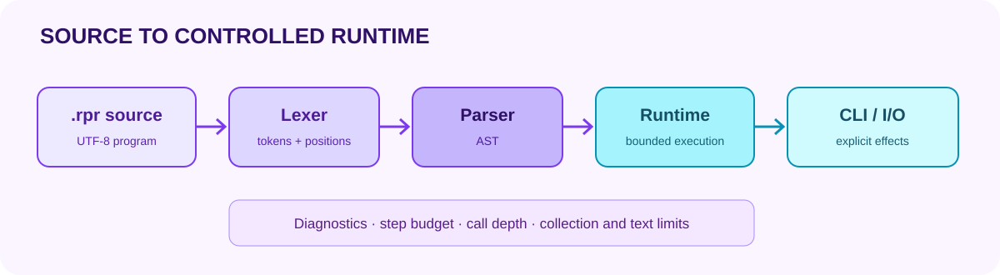

# Reaper
### A small, flow-first programming language

<p align="center"></p>
<p align="center"><strong>WRITE CLEARLY · COMPOSE FLOWS · KEEP EFFECTS EXPLICIT</strong><br>   </p>

**Reaper is an independent, flow-first programming language.** Its syntax keeps mutation explicit and lets values move through composable transformations. Version 0.1 is an executable milestone with a lexer, parser, tree-walking interpreter, CLI, examples, documentation and tests.

[English](README.md) · [Українська](README.uk.md) · [Русский](README.ru.md) · [简体中文](README.zh-CN.md)

## Make data flow visible

The `~>` operator passes the value on its left as the first argument to the operation on its right. Bindings are immutable by default; mutation is explicit.

<p align="center"></p>

```reaper
craft double(value) {
    yield value * 2
}

make numbers := [1, 2, 3, 4]
make answer := numbers ~> map(double) ~> sum()
emit "answer = " ++ text(answer)
```

## Run Reaper

Requirements: Python 3.10+. The interpreter uses only the Python standard library.

```bash
git clone https://github.com/Ivan-VHS/Reaper.git
cd Reaper
python -m reaper examples/hello.rpr
python -m reaper examples/flow.rpr
python -m reaper --check examples/flow.rpr
```

Install the command locally:

```bash
python -m pip install -e .
reaper examples/hello.rpr
```

<p align="center"></p>
<sub>Illustrative rendering based on checked-in examples, not a captured application screenshot.</sub>

## What version 0.1 includes

- Position-aware lexer with Unicode identifiers, comments and escaped text literals.
- Recursive-descent statement parser and Pratt expression parser.
- Immutable `make` bindings; explicit `vary` and `change` mutation.
- Functions, lexical closures, recursion and `yield`.
- Lists, indexing, arithmetic, comparisons, booleans and strict text concatenation.
- `when / otherwise`, `each` and `loop while`.
- Flow composition with `~>`, plus `map`, `keep`, `fold`, `sum` and related built-ins.
- Explicit console effects through `emit`, `say` and `ask`.
- Source-aware diagnostics and bounded execution.
- Standard-library tests and GitHub Actions CI for Python 3.10–3.12.

## Runtime architecture

<p align="center"></p>

| Layer | Responsibility |
|---|---|
| CLI | Arguments, UTF-8 source loading and check-only mode |
| Lexer | Deterministic tokens with source locations |
| Parser | Recursive-descent statements and Pratt expressions |
| Runtime | Lexical environments, functions, built-ins and flow composition |
| Diagnostics | File, line and column context for source errors |
| Tests & examples | Runnable examples and semantic regression tests |
| Packaging | Python package and CLI entry point; no third-party runtime dependencies |

## Resource limits

Defaults: 1,000,000 execution steps, 256 nested function calls, 100,000 collection items and 1,000,000 characters produced by text concatenation. Configure with `--steps`, `--items` and `--text-length`.

These limits bound workloads; they are **not a security sandbox**. Do not assume Reaper isolates untrusted programs from the host process.

## Roadmap

Static type checking, effect types, safe FFI boundaries, bytecode/native backends, structured concurrency, semantic graph tooling, package management and self-hosting are future milestones. GPU and distributed execution will only be claimed after real backends and conformance tests exist.

Read [LANGUAGE.md](LANGUAGE.md), [architecture](docs/ARCHITECTURE.md), [AETHER-ANAS roadmap](docs/AETHER_ANAS_ROADMAP.md), [examples](examples/) and [tests](tests/).

## License

Apache License 2.0 — see [LICENSE](LICENSE).
