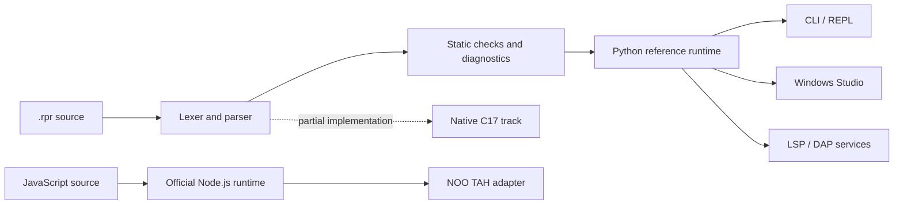

# Reaper

**A flow-first systems-programming language and local development workbench for compiler tooling, embedded software and hardware-adjacent programs.**

<picture>
  <source media="(prefers-color-scheme: dark)" srcset="assets/readme/dashboard.svg">
  
</picture>

  [](https://github.com/Ivan-VHS/Reaper/actions/workflows/ci.yml)
  [](LICENSE)

[English](README.md) · [Українська](README.uk.md) · [Русский](README.ru.md) · [简体中文](README.zh-CN.md)

**Implementation status:** the Python reference runtime, CLI/REPL, Windows Studio foundation, stdio LSP/DAP services and a partial native C17 track are present. Native compiler parity and privileged hardware services are not complete.

## Language workflow



The diagram distinguishes the available reference execution path from the incomplete native path and the external JavaScript runtime boundary.

## A small flow-first example

The following is the repository's `examples/flow.rpr` sample:

```reaper
craft double(value) {
    yield value * 2
}

craft is_large(value) {
    yield value >= 6
}

make values := [1, 2, 3, 4, 5]
make result := values :: map(double) :: keep(is_large)
```

The `::` operator passes the left-hand value into the next operation. The example file continues with a fold, loop and emitted results.

## What is included

| Component | Current scope |
|---|---|
| Language core | Reaper source language, lexer/parser, reference runtime and diagnostics |
| Developer tools | CLI, REPL and Windows Studio foundation |
| Language services | stdio LSP and DAP services |
| Native implementation | Experimental C17 path; not feature-equivalent to the reference runtime |
| NOO TAH | Delegates JavaScript execution to the official Node.js runtime |
| Jora | Application scaffolding and capability composition; catalogue packs remain specifications, not installable editors |
| Hardware-facing APIs | Checked contracts and adapters; not a complete privileged device runtime |

Explore the [feature matrix](docs/FEATURES.md), [architecture](docs/ARCHITECTURE.md), [hardware language design](docs/HARDWARE_LANGUAGE.md), [Jora factory](docs/JORA_APPLICATION_FACTORY.md), [Studio and IDE](docs/REAPER_IDE.md) and [NOO TAH](docs/NOO_TAH.md).

## Quick start

Requirements: Python 3.10–3.12 for the reference runtime; Node.js 22/24 for optional compatibility tests; Tkinter for Windows Studio; CMake 3.16+ and a C17 compiler for the native track.

```sh
python -m venv .venv
python -m pip install -e .
python -m reaper --check examples/flow.rpr
python -m reaper examples/flow.rpr
```

Open Studio or the REPL:

```sh
python reaper_desktop.py
python -m reaper --repl
```

Run the reference-runtime tests:

```sh
python -m unittest discover -s tests -v
```

## Architecture, roadmap and project policy

- [Implementation roadmap](docs/IMPLEMENTATION_ROADMAP.md)
- [Kora standard-library helpers](docs/KORA.md)
- [Documentation index](docs/README.md)
- [Shared ecosystem standards](https://github.com/Ivan-VHS/DuckOS/blob/main/docs/SHARED_STANDARDS.md)

A catalogue entry, policy contract or roadmap item is not proof of a completed native implementation. The reference runtime, partial C17 path, developer tools and external runtime adapters are tracked separately.

[Contributing](CONTRIBUTING.md) · [Security policy](SECURITY.md) · [Apache-2.0](LICENSE)
