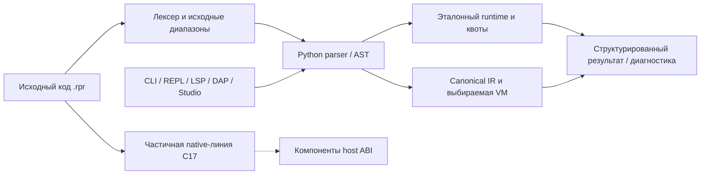

# Reaper — flow-first язык системного программирования

[English](README.md) · [Українська](README.uk.md) · [Русский](README.ru.md) · [简体中文](README.zh-CN.md)

> Язык `.rpr` с потоковой моделью, эталонная среда исполнения и развиваемый native-компилятор/toolchain C17 для программирования систем и аппаратно-ориентированных задач.

**Спецификация**

| Поле | Текущее состояние |
|---|---|
| Репозиторий | [Ivan-VHS/Reaper](https://github.com/Ivan-VHS/Reaper) |
| Статус продукта | Alpha / активная разработка; несколько линий реализации |
| Версия продукта | Единая версия выпуска не объявлена |
| Python-пакет | `reaper-lang 0.1.0`, Python 3.10+ |
| Нативная линия | C17 / CMake 3.16+; частичный компилятор и host ABI |
| Платформы runtime | Windows, Linux, macOS (эталонная среда) |
| Desktop | Windows Studio |
| Лицензия | [Apache-2.0](LICENSE) |
| Кодекс поведения | Отдельный `CODE_OF_CONDUCT.md` не опубликован |
| Проверка документации | 2026-11-26 |

<picture><source media="(prefers-color-scheme: dark)" srcset="assets/readme/dashboard.svg"></picture>

## Содержание

- [Назначение и область проекта](#назначение-и-область-проекта)
- [Архитектура](#архитектура-и-поток-выполнения)
- [Быстрый запуск](#быстрый-запуск)
- [Нативная линия C17](#нативная-линия-c17)
- [Интерфейсы и экосистема](#интерфейсы-и-экосистема)
- [Ограничения и безопасность](#ограничения-и-границы-безопасности)
- [Документация и вклад](#документация-и-вклад)
- [Версии и история](#версионирование-и-история)

## Назначение и область проекта

Reaper — язык программирования с приоритетом потоковой композиции и инструментарий разработчика для явных потоков данных, ограниченного выполнения, структурированной диагностики и системных экспериментов. Текущая реализация совместимости — эталонная среда исполнения на Python; отдельная линия C17 развивает native-компилятор и ABI-компоненты, но пока не обеспечивает паритет функций.

Для композиции значений язык использует оператор `::`. Исходные файлы имеют расширение `.rpr`. Эффекты файловой системы, процессов, сети, часов, shell и нативных библиотек должны оставаться явными или opt-in, а не становиться неявным поведением обычных выражений.

## Архитектура и поток выполнения



Эталонный runtime является источником совместимой семантики для реализованного поведения языка. Native-линия C17 развивается отдельно и должна пройти conformance-тесты до замены эталонных механизмов. Studio — Windows desktop-приложение; язык и CLI не ограничены Studio.

## Быстрый запуск

Требуется Python 3.10+; рекомендуется Git. Установите пакет в editable-режиме:

```sh
python -m venv .venv
python -m pip install -e .
python -m reaper --check examples/flow.rpr
python -m reaper examples/flow.rpr
```

Запуск REPL или Studio:

```sh
python -m reaper --repl
python reaper_desktop.py
```

Тесты эталонного runtime:

```sh
python -m unittest discover -s tests -v
```

Опции командной строки и ограничения определяются справкой CLI и документом [Runtime Platform](docs/RUNTIME_PLATFORM.md).

## Нативная линия C17

Требуются CMake 3.16+ и компилятор C17.

```sh
cmake -S . -B build -DCMAKE_BUILD_TYPE=Release -DREAPER_BUILD_TESTS=ON
cmake --build build --parallel
ctest --test-dir build --output-on-failure
```

Нативная линия включает lexer/parser, Canonical IR, optimizer/lowering и проверяемые ABI/tooling-компоненты. Это частичная реализация компилятора; она не означает полного покрытия языка, универсальной генерации машинного кода или freestanding-компиляции ядра.

## Интерфейсы и экосистема

| Интерфейс | Направление / применение | Граница |
|---|---|---|
| Pytyliki C ABI v1 | Необязательные native metric-вызовы | Явный путь к доверенной библиотеке; код выполняется в процессе |
| OPlague device snapshot v1 | Импорт JSON только для чтения и сравнение | Snapshot — свидетельство, а не сертификация |
| VentuSample pack v1/v2 | Файловая проверка метаданных | Читаются метаданные manifest; WAV не изменяются |
| Интеграция DAK | Связь политик и контрактов | Host/reference-контракты не означают интеграцию ядра |

Подробнее: [Federated Integration](docs/FEDERATED_INTEGRATION.md), [System Runtime ABI v1](docs/SYSTEM_RUNTIME_ABI_V1.md) и [NEXUS federation profile](docs/NEXUS_FEDERATION_PROFILE_V1.md). Смежные проекты сохраняют собственные лицензии и циклы выпуска.

## Ограничения и границы безопасности

> Квоты выполнения ограничивают ресурсы, но не являются sandbox для произвольных недоверенных программ.

Эталонный runtime Python остаётся реализацией совместимости по умолчанию. Native C17 реализован частично; self-hosting покрывает проверенное подмножество frontend, а не полный self-hosted-компилятор. Статическая проверка типов консервативна и не выводит неизвестные значения на границах модулей и host. C API MMIO проверяет дескрипторы и capabilities через адаптер, предоставленный хостом; он сам по себе не отображает физическую память и не управляет оборудованием.

Native FFI выполняет доверенный нативный код внутри процесса. Загружать следует только явно выбранные ABI-совместимые библиотеки. Файловая система, процессы, сеть, часы и shell остаются отдельными границами эффектов. Документация embedded/hardware описывает в том числе эталонные и симуляционные интерфейсы; это не прошивка устройств и не live hardware debugging.

Версия Python-пакета и версия CMake-проекта относятся к разным артефактам. Единый выпуск Reaper не объявлен.

## Документация и вклад

Начните с [индекса документации](docs/README.md) и [информационной архитектуры](docs/INFORMATION_ARCHITECTURE.md).

- [Матрица функций](docs/FEATURES.md)
- [Архитектура](docs/ARCHITECTURE.md)
- [Runtime platform и квоты](docs/RUNTIME_PLATFORM.md)
- [Нативный компилятор](docs/NATIVE_COMPILER.md)
- [Hardware language](docs/HARDWARE_LANGUAGE.md)
- [Studio и IDE](docs/REAPER_IDE.md)
- [Диагностика](docs/errors/DIAGNOSTICS.md)
- [Общий стандарт документации](docs/UNIFIED_DOCUMENTATION_STANDARD.md)

Перед изменением синтаксиса, runtime или публичных контрактов прочитайте [CONTRIBUTING.md](CONTRIBUTING.md). Сообщения об уязвимостях — согласно [SECURITY.md](SECURITY.md). Лицензия проекта — [Apache-2.0](LICENSE); сохраняйте стороннюю атрибуцию и уведомления.

## Версионирование и история

Python-дистрибутив сейчас указывает версию `0.1.0`, а нативный CMake-проект — `0.2.0`. Эти значения относятся к разным поставляемым компонентам и не являются единой версией языка. Проект находится на alpha-этапе. История выпусков и переходы совместимости должны ссылаться на реальные Git-теги, релизные артефакты и документы миграции; версия пакета сама по себе не подтверждает стабильность API.
