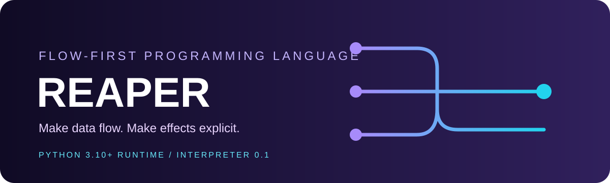
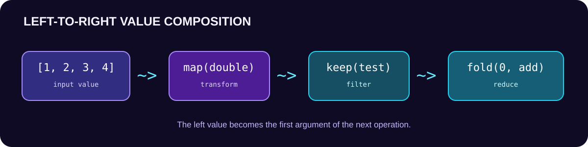
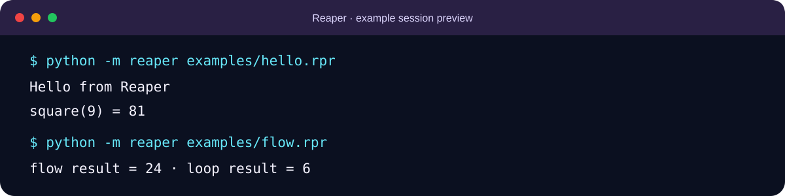
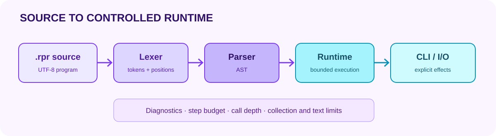

# Reaper
### Компактный язык программирования с композицией потоков

<p align="center"></p>
<p align="center"><strong>ПИШИТЕ ЯСНО · СОЕДИНЯЙТЕ ПОТОКИ · ЯВНО ОБОЗНАЧАЙТЕ ЭФФЕКТЫ</strong><br>   </p>

**Reaper — независимый язык программирования, построенный вокруг композиции потоков данных.** Синтаксис делает изменения состояния явными и позволяет передавать значения через последовательность преобразований. Версия 0.1 включает лексер, парсер, интерпретатор с обходом AST, CLI, примеры, документацию и тесты.

[English](README.md) · [Українська](README.uk.md) · [Русский](README.ru.md) · [简体中文](README.zh-CN.md)

## Сделайте поток данных видимым

Оператор `~>` передаёт значение слева первым аргументом операции справа. Привязки неизменяемы по умолчанию; изменение состояния обозначается явно.

<p align="center"></p>

```reaper
craft double(value) {
    yield value * 2
}

make numbers := [1, 2, 3, 4]
make answer := numbers ~> map(double) ~> sum()
emit "answer = " ++ text(answer)
```

## Запуск Reaper

Требования: Python 3.10 или новее. Интерпретатор использует только стандартную библиотеку Python.

```bash
git clone https://github.com/Ivan-VHS/Reaper.git
cd Reaper
python -m reaper examples/hello.rpr
python -m reaper examples/flow.rpr
python -m reaper --check examples/flow.rpr
```

Локальная установка команды:

```bash
python -m pip install -e .
reaper examples/hello.rpr
```

<p align="center"></p>
<sub>Иллюстрация на основе примеров из репозитория, а не снимок реально запущенного приложения.</sub>

## Возможности версии 0.1

- Лексер с позициями в исходном коде, Unicode-идентификаторами, комментариями и экранированием строк.
- Рекурсивный нисходящий парсер операторов и Pratt-парсер выражений.
- Неизменяемые привязки `make`; явное изменение через `vary` и `change`.
- Функции, лексические замыкания, рекурсия и `yield`.
- Списки, индексация, арифметика, сравнения, логические значения и строгое объединение текста.
- `when / otherwise`, `each` и `loop while`.
- Композиция через `~>`, а также `map`, `keep`, `fold`, `sum` и другие встроенные операции.
- Явные консольные эффекты через `emit`, `say` и `ask`.
- Диагностика с привязкой к исходному коду и ограниченное выполнение.
- Тесты на стандартной библиотеке и GitHub Actions CI для Python 3.10–3.12.

## Архитектура среды выполнения

<p align="center"></p>

| Слой | Назначение |
|---|---|
| CLI | Аргументы, загрузка UTF-8 исходников и режим проверки |
| Лексер | Детерминированные токены с позициями в исходнике |
| Парсер | Рекурсивный разбор операторов и Pratt-разбор выражений |
| Runtime | Лексические окружения, функции, встроенные операции и потоки |
| Диагностика | Файл, строка и столбец для ошибок исходного кода |
| Тесты и примеры | Исполняемые программы и регрессионные проверки |
| Упаковка | Python-пакет и CLI без сторонних runtime-зависимостей |

## Ограничения ресурсов

По умолчанию: 1 000 000 шагов выполнения, 256 уровней вложенных вызовов, 100 000 элементов коллекции и 1 000 000 символов, создаваемых конкатенацией текста. Настройка: `--steps`, `--items`, `--text-length`.

Эти лимиты ограничивают нагрузку, но **не являются песочницей безопасности**. Не считайте, что Reaper изолирует недоверенные программы от процесса хоста.

## Дорожная карта

Статическая типизация, типы эффектов, безопасные границы FFI, bytecode/native-бэкенды, структурированная конкурентность, семантические графы, менеджер пакетов и self-hosting — будущие этапы. GPU и распределённое выполнение будут заявлены только после появления реальных бэкендов и тестов соответствия.

Читайте [описание языка](LANGUAGE.md), [архитектуру](docs/ARCHITECTURE.md), [дорожную карту AETHER-ANAS](docs/AETHER_ANAS_ROADMAP.md), [примеры](examples/) и [тесты](tests/).

## Лицензия

Apache License 2.0 — см. [LICENSE](LICENSE).
