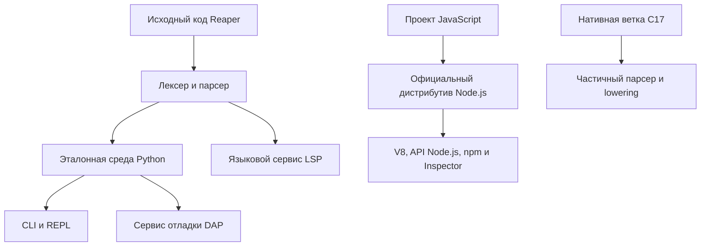
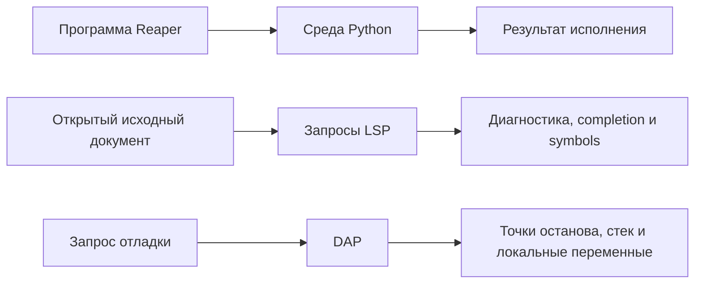

# Reaper — язык программирования с потоковой композицией

[English](README.md) · [Українська](README.uk.md) · [Русский](README.ru.md) · [简体中文](README.zh-CN.md)

[CI](https://github.com/Ivan-VHS/Reaper/actions/workflows/ci.yml) · [Сборка Windows Studio](https://github.com/Ivan-VHS/Reaper/actions/workflows/desktop-build.yml) · Python 3.10+ reference runtime · нативная ветка C17 · Windows Studio · Apache-2.0
**Разработчик:** [Ivan-VHS](https://github.com/Ivan-VHS)

Reaper — язык выражений с явным потоком данных: оператор `::` передаёт значение следующей операции. Python runtime остаётся текущей исполняемой эталонной реализацией. Реализация на C17 развивается отдельно и пока не заменяет runtime полностью.

**Языковой срез 0.2:** в эталонной грамматике реализованы `let/const/mut`, `fn/return`, `if/else`, `for/while`, `break/continue`, map-литералы и доступ к полям, оператор принадлежности и ленивый `??`. Новые возможности проверяются в tree-walk interpreter и stack VM. Полный перечень работающего синтаксиса и ограничений: [справочник языка Reaper 0.2](docs/LANGUAGE_REFERENCE_0.2.md).

## Реальный снимок Reaper Studio

<p align="center"></p>

## Поток функциональных данных

Схема показывает реализованное движение данных между источниками, этапами обработки и формируемыми результатами проекта.



## Пути выполнения и результатов

Вторая схема отделяет действующие пути выполнения и поддерживаемые результаты от каталожных или недоступных функций.



<sub>Фактический снимок приложения · исходное изображение 1920×1080 · исходные пиксели сохранены, искусственное увеличение не применяется.</sub>

## Актуальная матрица возможностей

| Область | Реализованные функции и границы |
|---|---|
| Python runtime | lexer, parser, интерпретатор, CLI, REPL, модули, closures, quotas и audit |
| Reaper Studio | основа Windows IDE: дерево проекта, редактор, подсветка, номера строк, поиск, check/run и отладчик |
| LSP | stdio-сервис: инкрементальные UTF-16-документы, диагностика parser/structure, completion, hover, symbols и лексическая навигация; анализ в пределах открытого файла |
| DAP | stdio debug adapter: запуск, построчные breakpoints, пошаговое выполнение операторов, stack и локальные переменные |
| Деление и распределение | проверенное деление Евклида, сбалансированное разбиение работ и пропорциональное распределение |
| Atomic-Quantum 133 | 133 ID операций; 8 проверенных ядер классической симуляции; остальные записи только каталогизированы | ограниченная модель вектора состояния до 10 кубитов; без доступа к квантовому оборудованию |
| NOO TAH | интеграция официального Node.js: V8/libuv, ESM/CommonJS, core APIs, streams, workers, npm/npx, N-API и Inspector; JS Run/Check/Debug/Stop в Studio |
| Внутренние плагины | 18 встроенных сервисов с lifecycle-состоянием и ограниченным dispatch; Python reference runtime |
| Kora | 66 стандартных utility-функций в семи модулях с манифестами; три Lua ReaScript для Cockos REAPER |
| Native C17 | lexer, expression parser, owned AST, checked IR и ограниченный lowering; без полного паритета с Python runtime |
| МОСТ | 54 точных алиаса: 21 исполняется в текущем reference subset, 33 зарезервированы лексически |
| QCS 1.0 | отдельный hardware-domain parser и JSON AST; без управления оборудованием |
| THESIS | типизированный граф доказательств; утверждения автоматически не подтверждаются |
| Реестры | 813 предложений функций, 666 API-контрактов и 666 зарезервированных лексем; запись реестра не означает готовую реализацию |
| Федерация | snapshots OPlague, manifests VentuSample и опциональный Pytyliki C ABI |

## CODEX-66 — рабочая среда IDE

В Reaper Studio добавлен нативный каталог возможностей **CODEX-66**: шесть групп по одиннадцать пунктов, поиск по ID, названию, категории и зрелости реализации. **Ctrl+Space** открывает локальные подсказки REAPER, **F12** переходит к объявлению в текущем документе, **Найти ссылки** показывает лексические вхождения, а **Ctrl+Shift+R** переименовывает символ в текущем документе. **Ctrl+K** открывает палитру команд.

Каталог разделяет реализованные, частичные, запланированные и неподдерживаемые функции. Подсказки работают через локальный language service, это не облачный AI. Поиск ссылок и переименование ограничены текущим документом; interpreter не является OS-песочницей. Подробности: [CODEX-66 — реализация и ограничения](docs/CODEX_66_SHOWCASE.md).

## Сервисы языка и отладки

Инструменты редактора предоставляют stdio-протоколы:

```sh
python -m reaper lsp
python -m reaper dap
```

Установленные entry points: `reaper-lsp` и `reaper-dap`. LSP обеспечивает инкрементальные функции языка на уровне документа. DAP отлаживает программы Reaper. Сервисы используют канонический Python parser/runtime и не означают полного паритета C17, межфайлового семантического анализа или наличия готового VS Code-клиента.

Подробности и ограничения: [архитектура REAPER IDE](docs/REAPER_IDE.md).

## NOO TAH — среда Node.js

NOO TAH управляет официальной кроссплатформенной сборкой Node.js, а не имитирует её движок. V8, libuv, системные модули, ESM/CommonJS, streams, workers, child processes, npm/npx, N-API и Inspector предоставляются выбранным дистрибутивом Node.

Reaper Studio распознаёт проекты `.js`, `.mjs` и `.cjs`; доступны JS Run, JS Check, JS Debug через Node Inspector, JS Stop, npm-команды и диагностика runtime. Node Inspector пока не преобразуется в панели нативного DAP-отладчика.

```sh
reaper-noo-tah version
reaper-noo-tah doctor
reaper-noo-tah run app.mjs
reaper-noo-tah check app.js
reaper-noo-tah npm run build
node --test tests/noo_tah/conformance.test.mjs
```

Тесты совместимости проверяют метаданные runtime, ESM/CommonJS, файловый ввод-вывод, crypto, streams/backpressure, loopback HTTP/TCP, workers, child processes, DNS и порядок event loop. CI-матрица использует Node 22 и 24 на Windows, Linux и macOS. См. [архитектуру NOO TAH](docs/NOO_TAH.md).

## Kora и приложения для Cockos REAPER

Kora содержит 66 стандартных utility-функций в модулях ZDORO, DILLY, BAPLAP, KALI, PYEMONT, LIUR и SRETUO. Также доступны три Lua ReaScript:

- **Track Health Dashboard** — диагностика проекта и дорожек без изменений.
- **Prefix Selected Tracks** — переименование выбранных дорожек одной undoable-операцией.
- **Marker and Region Report** — список маркеров и регионов в ReaScript console.

В Cockos REAPER откройте **Actions → Show action list → ReaScript → Load** и выберите скрипт из `reaper_scripts/kora/`. Это скрипты для встроенного хоста REAPER, а не скомпилированные VST/AU/CLAP-эффекты. Отдельный процесс Node.js для них не нужен. См. [Kora для REAPER](docs/KORA_REAPER.md).

## Atomic-Quantum 133

Python reference runtime содержит 133 стабильных ID операций в шести семействах: состояния, запутанность, измерения, шум/ECC, атомная динамика и алгоритмы/телеметрия. Сейчас восемь проверенных ядер обеспечивают ограниченную детерминированную классическую симуляцию; остальные записи явно имеют статус **catalogued-only** и не считаются реализованными. Вектор состояния ограничен 10 кубитами, проверяет конечность амплитуд и нормировку, поддерживает измерения с заданным seed. Доступа к квантовому оборудованию, его обнаружения, калибровки или управления нет; C17-трек не является квантовым исполнением. См. [контракт Atomic-Quantum 133](docs/ATOMIC_QUANTUM_133.md).

## Запуск, тесты и сборка

```sh
python -m reaper examples/flow.rpr
python -m reaper --check examples/flow.rpr
python -m reaper --engine vm examples/flow.rpr
python -m reaper --repl
python -m unittest discover -s tests -v
```

Windows Studio: `python reaper_desktop.py`.

Нативная ветка C17:

```sh
cmake -S . -B build -DCMAKE_BUILD_TYPE=Release
cmake --build build --parallel
ctest --test-dir build --output-on-failure
```

Пример:

```reaper
craft double(value) { yield value * 2 }
make result := [1, 2, 3] :: map(double) :: sum()
emit "result = " ++ text(result)
```

[Контракт IDE 666](docs/IDE_666_IMPLEMENTATION.md) · [LSP/DAP](docs/REAPER_IDE.md) · [Node.js](docs/NOO_TAH.md) · [Kora для REAPER](docs/KORA_REAPER.md) · [Плагины](docs/PLUGINS.md) · [Внутренние продукты](docs/INTERNAL_PRODUCTS.md) · [Функции](docs/FEATURES.md) · [Язык](LANGUAGE.md) · [Архитектура](docs/ARCHITECTURE.md) · [Реестр 813](docs/REAPER_813_FEATURE_ARCHITECTURE.md) · [Федерация](docs/PROJECT_FEDERATION_MATRIX.md) · [Индекс](docs/README.md)

[English](README.md) · [Українська](README.uk.md) · [简体中文](README.zh-CN.md) · [Релизы](https://github.com/Ivan-VHS/Reaper/releases) · [Apache-2.0](LICENSE)


## Справочник распределения бюджета
Пример модели бюджета 500 грн с JSON-контрактом и автономным симулятором. Это документационный пример, а не функция runtime самого приложения.

[Мультиязычный справочник](docs/RESOURCE_ALLOCATION_500_UAH.md) · [Интерактивный симулятор](docs/resource-allocation-500-uah.html) · [Пример JSON](examples/resource-allocation-500-uah.json) · [JSON Schema](schemas/resource-allocation.v1.schema.json)
