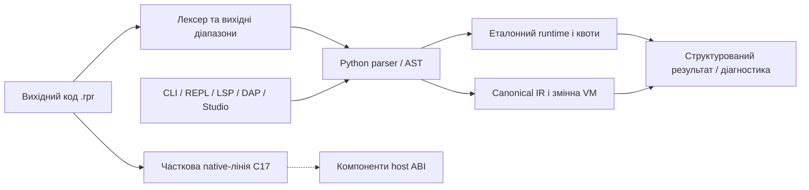

# Reaper — flow-first мова системного програмування

[English](README.md) · [Українська](README.uk.md) · [Русский](README.ru.md) · [简体中文](README.zh-CN.md)

> Мова `.rpr` із потоковою моделлю, еталонне середовище виконання та native-компілятор/toolchain C17, що розвивається, для системного й апаратно-орієнтованого програмування.

**Специфікація**

| Поле | Поточний запис |
|---|---|
| Репозиторій | [Ivan-VHS/Reaper](https://github.com/Ivan-VHS/Reaper) |
| Стан продукту | Alpha / активна розробка; кілька ліній реалізації |
| Версія продукту | Єдину версію випуску не оголошено |
| Python-пакет | `reaper-lang 0.1.0`, Python 3.10+ |
| Нативна лінія | C17 / CMake 3.16+; частковий компілятор і host ABI |
| Платформи runtime | Windows, Linux, macOS (еталонне середовище) |
| Desktop | Windows Studio |
| Ліцензія | [Apache-2.0](LICENSE) |
| Кодекс поведінки | Окремий `CODE_OF_CONDUCT.md` не опубліковано |
| Перевірка документації | 2026-11-26 |

<picture><source media="(prefers-color-scheme: dark)" srcset="assets/readme/dashboard.svg"></picture>

## Зміст

- [Призначення та межі](#призначення-та-межі-проєкту)
- [Архітектура](#архітектура-та-потік-виконання)
- [Швидкий старт](#швидкий-старт)
- [Нативна лінія C17](#нативна-лінія-c17)
- [Інтерфейси й екосистема](#інтерфейси-й-екосистема)
- [Обмеження та безпека](#обмеження-та-межі-безпеки)
- [Документація та внесок](#документація-та-внесок)
- [Версії та історія](#версії-та-історія)

## Призначення та межі проєкту

Reaper — мова програмування з пріоритетом потокової композиції та інструментарій розробника для явних потоків даних, обмеженого виконання, структурованої діагностики й системних експериментів. Поточна реалізація сумісності — еталонне середовище виконання на Python; окрема лінія C17 розвиває native-компілятор та ABI-компоненти, але ще не має паритету можливостей.

Для композиції значень мова використовує оператор `::`. Файли мають розширення `.rpr`. Ефекти файлової системи, процесів, мережі, годинника, shell та native-бібліотек мають залишатися явними або opt-in, а не ставати неявною поведінкою звичайних виразів.

## Архітектура та потік виконання



Еталонний runtime є джерелом сумісної семантики для реалізованої поведінки мови. Native-лінія C17 розвивається окремо й має пройти conformance-тести, перш ніж замінювати еталонну поведінку. Studio — Windows desktop-застосунок; мова та CLI не обмежені Studio.

## Швидкий старт

Потрібен Python 3.10+; Git рекомендовано. Встановіть пакет в editable-режимі:

```sh
python -m venv .venv
python -m pip install -e .
python -m reaper --check examples/flow.rpr
python -m reaper examples/flow.rpr
```

Запуск REPL або Studio:

```sh
python -m reaper --repl
python reaper_desktop.py
```

Тести еталонного runtime:

```sh
python -m unittest discover -s tests -v
```

Опції CLI та обмеження визначаються довідкою командного рядка й документом [Runtime Platform](docs/RUNTIME_PLATFORM.md).

## Нативна лінія C17

Потрібні CMake 3.16+ та компілятор C17.

```sh
cmake -S . -B build -DCMAKE_BUILD_TYPE=Release -DREAPER_BUILD_TESTS=ON
cmake --build build --parallel
ctest --test-dir build --output-on-failure
```

Нативна лінія містить lexer/parser, Canonical IR, optimizer/lowering і перевірені ABI/tooling-компоненти. Це часткова реалізація компілятора; вона не означає повного покриття мови, універсальної генерації машинного коду або freestanding-компіляції ядра.

## Інтерфейси й екосистема

| Інтерфейс | Напрям / використання | Межа |
|---|---|---|
| Pytyliki C ABI v1 | Необов’язкові native metric-виклики | Явний шлях довіреної бібліотеки; виконання в процесі |
| OPlague device snapshot v1 | Імпорт JSON лише для читання та порівняння | Snapshot — доказ, а не сертифікація |
| VentuSample pack v1/v2 | Файлова перевірка метаданих | Читаються лише метадані manifest; WAV не змінюються |
| Інтеграція DAK | Зв’язок політик і контрактів | Host/reference-контракти не означають інтеграцію з ядром |

Див. [Federated Integration](docs/FEDERATED_INTEGRATION.md), [System Runtime ABI v1](docs/SYSTEM_RUNTIME_ABI_V1.md) та [NEXUS federation profile](docs/NEXUS_FEDERATION_PROFILE_V1.md). Суміжні проєкти мають власні ліцензії та цикли випуску.

## Обмеження та межі безпеки

> Квоти виконання обмежують ресурси, але не є sandbox для довільних недовірених програм.

Еталонний Python runtime залишається реалізацією сумісності за замовчуванням. Native C17 реалізовано частково; self-hosting охоплює перевірену підмножину frontend, а не повний self-hosted-компілятор. Статична перевірка типів консервативна та залишає невідомі значення на межах модулів і host невизначеними. C API MMIO перевіряє дескриптори й capabilities через адаптер хоста; він сам не відображає фізичну пам’ять і не керує обладнанням.

Native FFI виконує довірений нативний код усередині процесу. Завантажуйте лише явно вибрані ABI-сумісні бібліотеки. Файлова система, процеси, мережа, годинник і shell залишаються окремими межами ефектів. Документація embedded/hardware описує також еталонні та симуляційні поверхні; це не прошивання пристроїв і не live hardware debugging.

Версії Python-пакета та CMake-проєкту стосуються різних артефактів. Єдиний випуск Reaper не оголошено.

## Документація та внесок

Почніть з [індексу документації](docs/README.md) та [інформаційної архітектури](docs/INFORMATION_ARCHITECTURE.md).

- [Матриця функцій](docs/FEATURES.md)
- [Архітектура](docs/ARCHITECTURE.md)
- [Runtime platform і квоти](docs/RUNTIME_PLATFORM.md)
- [Нативний компілятор](docs/NATIVE_COMPILER.md)
- [Hardware language](docs/HARDWARE_LANGUAGE.md)
- [Studio та IDE](docs/REAPER_IDE.md)
- [Діагностика](docs/errors/DIAGNOSTICS.md)
- [Спільний стандарт документації](docs/UNIFIED_DOCUMENTATION_STANDARD.md)

Перед змінами синтаксису, runtime або публічних контрактів прочитайте [CONTRIBUTING.md](CONTRIBUTING.md). Повідомлення про вразливості обробляються за [SECURITY.md](SECURITY.md). Ліцензія — [Apache-2.0](LICENSE); зберігайте сторонню атрибуцію та повідомлення.

## Версії та історія

Python-дистрибутив зараз декларує версію `0.1.0`, а native CMake-проєкт — `0.2.0`. Це різні компоненти постачання, а не єдина версія мови. Проєкт перебуває на alpha-етапі. Історія випусків і переходи сумісності мають посилатися на реальні Git-теги, релізні артефакти та документи міграції; версія пакета сама по собі не підтверджує стабільність API.
