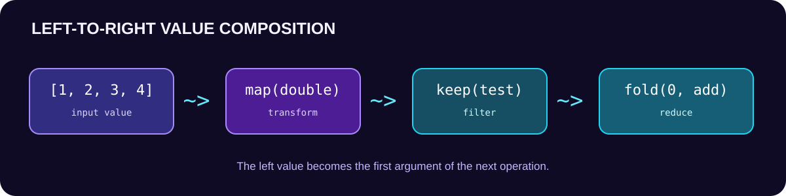

# Reaper
### Компактна мова програмування з композицією потоків

<p align="center"></p>
<p align="center"><strong>ПИШІТЬ ЗРОЗУМІЛО · ПОЄДНУЙТЕ ПОТОКИ · ЯВНО ПОЗНАЧАЙТЕ ЕФЕКТИ</strong><br>   </p>

**Reaper — незалежна мова програмування, побудована навколо композиції потоків даних.** Синтаксис робить зміни стану явними й дає змогу передавати значення через послідовність перетворень. Версія 0.1 містить лексер, парсер, інтерпретатор з обходом AST, CLI, приклади, документацію та тести.

[English](README.md) · [Українська](README.uk.md) · [Русский](README.ru.md) · [简体中文](README.zh-CN.md)

## Зробіть потік даних видимим

Оператор `~>` передає значення ліворуч першим аргументом операції праворуч. Прив'язки незмінні за замовчуванням; зміна стану позначається явно.

<p align="center"></p>

```reaper
craft double(value) {
    yield value * 2
}

make numbers := [1, 2, 3, 4]
make answer := numbers ~> map(double) ~> sum()
emit "answer = " ++ text(answer)
```

## Запуск Reaper

Вимоги: Python 3.10 або новіший. Інтерпретатор використовує лише стандартну бібліотеку Python.

```bash
git clone https://github.com/Ivan-VHS/Reaper.git
cd Reaper
python -m reaper examples/hello.rpr
python -m reaper examples/flow.rpr
python -m reaper --check examples/flow.rpr
```

Локальне встановлення команди:

```bash
python -m pip install -e .
reaper examples/hello.rpr
```

<p align="center"></p>
<sub>Ілюстрація на основі прикладів у репозиторії, а не знімок реально запущеної програми.</sub>

## Можливості версії 0.1

- Лексер із позиціями у вихідному коді, Unicode-ідентифікаторами, коментарями та екрануванням рядків.
- Рекурсивний низхідний парсер операторів і Pratt-парсер виразів.
- Незмінні прив'язки `make`; явна зміна через `vary` і `change`.
- Функції, лексичні замикання, рекурсія та `yield`.
- Списки, індексація, арифметика, порівняння, логічні значення та суворе об'єднання тексту.
- `when / otherwise`, `each` і `loop while`.
- Композиція через `~>`, а також `map`, `keep`, `fold`, `sum` та інші вбудовані операції.
- Явні консольні ефекти через `emit`, `say` і `ask`.
- Діагностика з прив'язкою до вихідного коду та обмежене виконання.
- Тести на стандартній бібліотеці й GitHub Actions CI для Python 3.10–3.12.

## Архітектура середовища виконання

<p align="center"></p>

| Рівень | Призначення |
|---|---|
| CLI | Аргументи, завантаження UTF-8 коду та режим перевірки |
| Лексер | Детерміновані токени з позиціями у вихідному коді |
| Парсер | Рекурсивний розбір операторів і Pratt-розбір виразів |
| Runtime | Лексичні середовища, функції, вбудовані операції та потоки |
| Діагностика | Файл, рядок і стовпець для помилок вихідного коду |
| Тести й приклади | Виконувані програми та регресійні перевірки |
| Пакування | Python-пакет і CLI без сторонніх runtime-залежностей |

## Обмеження ресурсів

За замовчуванням: 1 000 000 кроків виконання, 256 рівнів вкладених викликів, 100 000 елементів колекції та 1 000 000 символів, створених конкатенацією тексту. Параметри: `--steps`, `--items`, `--text-length`.

Ці ліміти обмежують навантаження, але **не є пісочницею безпеки**. Не вважайте, що Reaper ізолює недовірені програми від процесу хоста.

## Дорожня карта

Статична типізація, типи ефектів, безпечні межі FFI, bytecode/native-бекенди, структурована конкурентність, семантичні графи, менеджер пакетів і self-hosting — майбутні етапи. GPU та розподілене виконання заявлятимуться лише після появи реальних бекендів і тестів відповідності.

Читайте [опис мови](LANGUAGE.md), [архітектуру](docs/ARCHITECTURE.md), [дорожню карту AETHER-ANAS](docs/AETHER_ANAS_ROADMAP.md), [приклади](examples/) і [тести](tests/).

## Ліцензія

Apache License 2.0 — див. [LICENSE](LICENSE).
