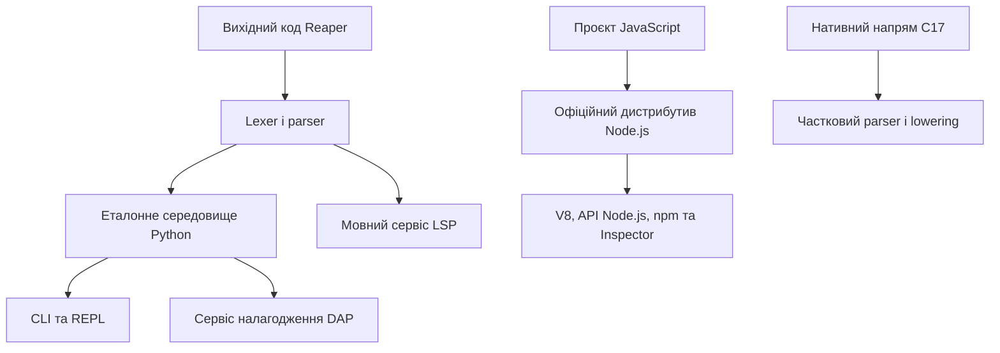
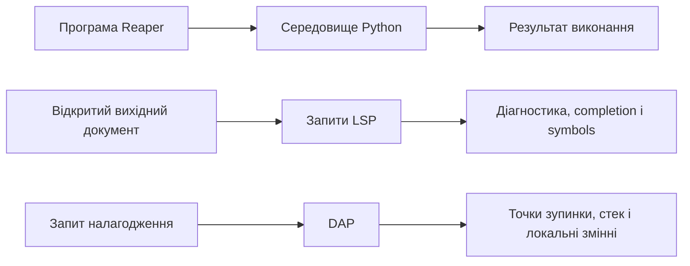

# Reaper — мова програмування з потоковою композицією

[English](README.md) · [Українська](README.uk.md) · [Русский](README.ru.md) · [简体中文](README.zh-CN.md)

[CI](https://github.com/Ivan-VHS/Reaper/actions/workflows/ci.yml) · [Збирання Windows Studio](https://github.com/Ivan-VHS/Reaper/actions/workflows/desktop-build.yml) · Python 3.10+ reference runtime · нативний напрям C17 · Windows Studio · Apache-2.0
**Розробник:** [Ivan-VHS](https://github.com/Ivan-VHS)

Reaper — мова виразів із явним потоком даних: оператор `::` передає значення наступній операції. Python runtime залишається поточною еталонною виконуваною реалізацією. Реалізація C17 розвивається окремо й поки не є повною заміною runtime.

## Реальний знімок Reaper Studio

<p align="center"></p>

## Потік функціональних даних

Схема показує реалізований рух даних між джерелами, етапами обробки та сформованими результатами проєкту.



## Шляхи виконання та результатів

Друга схема відокремлює чинні шляхи виконання й підтримувані результати від каталожних або недоступних функцій.



<sub>Фактичний знімок програми · вихідне зображення 1920×1080 · початкові пікселі збережено, штучне збільшення не застосовується.</sub>

## Актуальна матриця можливостей

| Область | Реалізовані функції та межі |
|---|---|
| Python runtime | lexer, parser, інтерпретатор, CLI, REPL, модулі, closures, `attempt/recover/finally/throw`, quotas та audit |
| Reaper Studio | основа Windows IDE: дерево проєкту, редактор, підсвічування, номери рядків, пошук, check/run та налагоджувач |
| LSP | stdio-сервіс: інкрементальні UTF-16-документи, parser/structure діагностика, completion, hover, symbols і лексична навігація; аналіз у межах відкритого файла |
| DAP | stdio debug adapter: запуск, построкові breakpoints, покрокове виконання операторів, stack і локальні змінні |
| Ділення й розподіл | перевірене ділення Евкліда, збалансоване розбиття роботи та пропорційний розподіл |
| Atomic-Quantum 133 | 133 ID операцій; 8 перевірених ядер класичної симуляції; решта записів лише каталогізовані | обмежена модель вектора стану до 10 кубітів; без доступу до квантового обладнання |
| NOO TAH | інтеграція офіційного Node.js: V8/libuv, ESM/CommonJS, core APIs, streams, workers, npm/npx, N-API та Inspector; JS Run/Check/Debug/Stop у Studio |
| Внутрішні плагіни | 18 вбудованих сервісів із lifecycle-станом та обмеженим dispatch; Python reference runtime |
| Kora | 66 стандартних utility-функцій у семи модулях із маніфестами; три Lua ReaScript для Cockos REAPER |
| Native C17 | lexer, expression parser, owned AST, checked IR і обмежений lowering; без повного паритету з Python runtime |
| МОСТ | 54 точні аліаси: 21 виконується в поточному reference subset, 33 зарезервовані лексично |
| QCS 1.0 | окремий hardware-domain parser та JSON AST; без керування обладнанням |
| THESIS | типізований граф доказів; твердження не підтверджуються автоматично |
| Реєстри | 813 пропозицій функцій, 666 API-контрактів і 666 зарезервованих лексем; запис у реєстрі не означає готової реалізації |
| Федерація | snapshots OPlague, manifests VentuSample та опційний Pytyliki C ABI |

## CODEX-66 — робоче середовище IDE

У Reaper Studio додано нативний каталог можливостей **CODEX-66**: шість груп по одинадцять пунктів, пошук за ID, назвою, категорією та зрілістю реалізації. **Ctrl+Space** відкриває локальні підказки REAPER, **F12** переходить до оголошення в поточному документі, **Знайти посилання** показує лексичні входження, а **Ctrl+Shift+R** перейменовує символ у поточному документі. **Ctrl+K** відкриває палітру команд.

Каталог розрізняє реалізовані, часткові, заплановані й непідтримувані функції. Підказки працюють через локальний language service — це не хмарний AI. Пошук посилань і перейменування обмежені поточним документом; interpreter не є OS-пісочницею. Докладніше: [CODEX-66 — реалізація та межі](docs/CODEX_66_SHOWCASE.md).

## Сервіси мови та налагодження

Інструменти редактора надають stdio-протоколи:

```sh
python -m reaper lsp
python -m reaper dap
```

Встановлені entry points: `reaper-lsp` і `reaper-dap`. LSP надає інкрементальні мовні функції на рівні документа. DAP налагоджує програми Reaper. Сервіси використовують канонічний Python parser/runtime; це не означає повного паритету C17, міжфайлового семантичного аналізу чи готового VS Code-клієнта.

Точні можливості та межі: [архітектура REAPER IDE](docs/REAPER_IDE.md).

## NOO TAH — середовище Node.js

NOO TAH керує офіційним кросплатформним дистрибутивом Node.js, а не відтворює його рушій. V8, libuv, системні модулі, ESM/CommonJS, streams, workers, child processes, npm/npx, N-API та Inspector надає вибраний дистрибутив Node.

Reaper Studio розпізнає проєкти `.js`, `.mjs` і `.cjs`; доступні JS Run, JS Check, JS Debug через Node Inspector, JS Stop, npm-команди й діагностика runtime. Node Inspector поки не інтегровано в панелі нативного DAP-налагоджувача.

```sh
reaper-noo-tah version
reaper-noo-tah doctor
reaper-noo-tah run app.mjs
reaper-noo-tah check app.js
reaper-noo-tah npm run build
node --test tests/noo_tah/conformance.test.mjs
```

Тести сумісності перевіряють метадані runtime, ESM/CommonJS, файлове введення-виведення, crypto, streams/backpressure, loopback HTTP/TCP, workers, child processes, DNS і порядок event loop. CI-матриця використовує Node 22 та 24 на Windows, Linux і macOS. Документація: [NOO TAH](docs/NOO_TAH.md).

## Kora та застосунки для Cockos REAPER

Kora містить 66 стандартних utility-функцій у модулях ZDORO, DILLY, BAPLAP, KALI, PYEMONT, LIUR і SRETUO. Також доступні три Lua ReaScript:

- **Track Health Dashboard** — діагностика проєкту й доріжок без змін.
- **Prefix Selected Tracks** — перейменування вибраних доріжок однією undoable-операцією.
- **Marker and Region Report** — список маркерів і регіонів у ReaScript console.

У Cockos REAPER відкрийте **Actions → Show action list → ReaScript → Load** і виберіть скрипт із `reaper_scripts/kora/`. Це скрипти для вбудованого хоста REAPER, а не скомпільовані VST/AU/CLAP-ефекти. Окремий процес Node.js їм не потрібен. Документація: [Kora для REAPER](docs/KORA_REAPER.md).

## Atomic-Quantum 133

Python reference runtime містить 133 стабільні ID операцій у шести сімействах: стани, заплутаність, вимірювання, шум/ECC, атомна динаміка й алгоритми/телеметрія. Наразі вісім перевірених ядер забезпечують обмежену детерміновану класичну симуляцію; решта записів мають статус **catalogued-only** і не вважаються реалізованими. Вектор стану обмежений 10 кубітами, перевіряє скінченність амплітуд і нормалізацію та підтримує вимірювання із заданим seed. Доступу до квантового обладнання, його виявлення, калібрування чи керування немає; C17-трек не є квантовим виконанням. Докладніше: [контракт Atomic-Quantum 133](docs/ATOMIC_QUANTUM_133.md).

## Запуск, тести та збирання

```sh
python -m reaper examples/flow.rpr
python -m reaper examples/error_handling.rpr
python -m reaper --check examples/flow.rpr
python -m reaper --engine vm examples/flow.rpr
python -m reaper --repl
python -m unittest discover -s tests -v
```

Windows Studio: `python reaper_desktop.py`.

Нативний напрям C17:

```sh
cmake -S . -B build -DCMAKE_BUILD_TYPE=Release
cmake --build build --parallel
ctest --test-dir build --output-on-failure
```

Приклад:

```reaper
craft double(value) { yield value * 2 }
make result := [1, 2, 3] :: map(double) :: sum()
emit "result = " ++ text(result)
```

[Контракт IDE 666](docs/IDE_666_IMPLEMENTATION.md) · [LSP/DAP](docs/REAPER_IDE.md) · [Node.js](docs/NOO_TAH.md) · [Kora для REAPER](docs/KORA_REAPER.md) · [Плагіни](docs/PLUGINS.md) · [Внутрішні продукти](docs/INTERNAL_PRODUCTS.md) · [Можливості](docs/FEATURES.md) · [Мова](LANGUAGE.md) · [Архітектура](docs/ARCHITECTURE.md) · [Реєстр 813](docs/REAPER_813_FEATURE_ARCHITECTURE.md) · [Федерація](docs/PROJECT_FEDERATION_MATRIX.md) · [Індекс](docs/README.md)

[English](README.md) · [Русский](README.ru.md) · [简体中文](README.zh-CN.md) · [Релізи](https://github.com/Ivan-VHS/Reaper/releases) · [Apache-2.0](LICENSE)


## Довідник розподілу бюджету
Приклад моделі бюджету 500 грн із JSON-контрактом та автономним симулятором. Це документаційний приклад, а не функція runtime самого застосунку.

[Багатомовний довідник](docs/RESOURCE_ALLOCATION_500_UAH.md) · [Інтерактивний симулятор](docs/resource-allocation-500-uah.html) · [Приклад JSON](examples/resource-allocation-500-uah.json) · [JSON Schema](schemas/resource-allocation.v1.schema.json)
