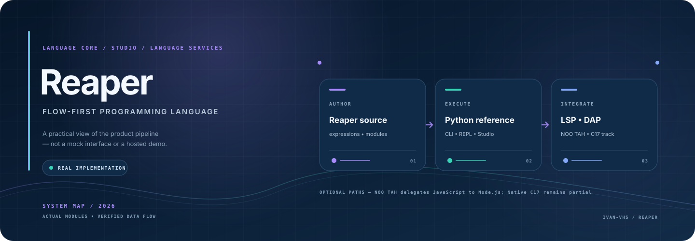

# Reaper — низькорівнева системна мова та середовище розробки апаратури

[English](README.md) · [Українська](README.uk.md) · [Русский](README.ru.md) · [简体中文](README.zh-CN.md)

<p align="center"></p>

[Вихідний код](https://github.com/Ivan-VHS/Reaper) · [Python CI](.github/workflows/ci.yml) · [Збирання Windows Studio](.github/workflows/desktop-build.yml) · [Сумісність Node.js](.github/workflows/noo-tah.yml) · [Індекс документації](docs/README.md) · [Apache-2.0](LICENSE)

## Реальний знімок Studio

<p align="center"><a href="assets/screenshots/reaper-studio.png"></a></p>
<p align="center"><sub>1920×1080 · Натисніть зображення, щоб відкрити оригінальний PNG.</sub></p>

Справжній знімок запущеного вікна Reaper Studio у Windows, створений screenshot workflow цього репозиторію. Банер і схема потоку — авторські SVG-ілюстрації, а не скріншоти.

### Архітектура одним поглядом

<p align="center"></p>

Реальний шлях: вихідний `.rpr` → lexer і parser → Python reference runtime → CLI, Studio, LSP та DAP.


[](https://github.com/Ivan-VHS/Reaper/actions/workflows/ci.yml)  [](https://github.com/Ivan-VHS/Reaper/actions/workflows/readme-screenshots.yml)  [](LICENSE)


> **Призначення:** Reaper переорієнтовується на низькорівневу системну мову та робоче середовище для прошивок, embedded-розробки й апаратно-залежного ПЗ, зберігаючи сумісність із чинними .rpr-програмами та Python runtime. Це локальні інструменти й Windows desktop IDE, а не hosted web service. Стан звірено **23.11.2026**.

## Призначення та стан реалізації

Reaper розвивається як системна мова для прошивок, embedded-програм, платформних компонентів і програмного забезпечення поруч з апаратурою. Потокова композиція через `::` залишається частиною мови; зберігаються Python reference runtime, CLI/REPL, Windows Studio, LSP/DAP і необов’язкова інтеграція NOO TAH.

**Вже доступно:** обмежений native scalar AOT через C17, часткове C17-ядро lexer/parser/IR, QCS-перевірка апаратних описів, MCU-профілі з генерацією linker script і новий перевірний MMIO API, який працює лише через переданий платформний адаптер.

**Ще розробляється:** повноцінні типи, ownership/borrowing/effects, загальний backend машинного коду, апаратні конструкції всередині `.rpr`, реальні OS/driver MMIO/IRQ/DMA-сервіси та повний апаратний workspace Studio. Етапи й точні межі: [Hardware Language](docs/HARDWARE_LANGUAGE.md).

Цільова аудиторія — embedded- і firmware-розробники, системні програмісти, інженери платформ/драйверів, розробники компіляторів і викладачі.

### Що реалізовано

| Компонент | Поточний обсяг | Межа |
|---|---|---|
| Python runtime | lexer, parser, interpreter, CLI, REPL, модулі, closures, quotas та audit log | поточна виконувана еталонна реалізація |
| Static type analysis | виведення базових і list-типів, перевірка операторів/індексів, змінності та арності викликів | часткова реалізація; запуск через `reaper typecheck` |
| Reaper Studio | основа Windows IDE, дерево/редактор/debugger та огляд Systems/Hardware з MCU-профілями й межами доступу | локальний desktop-застосунок; без live-інспектора пристроїв |
| LSP | stdio JSON-RPC, diagnostics, completion, hover, symbols, лексична навігація, форматування та локальна перевірка типів | відкритий документ; без міжфайлового type inference |
| Інвентаризація toolchain | пошук компіляторів, систем збирання, парсерів, форматтерів, налагоджувачів і WASM runtime з фіксацією SHA-256 | лише PATH і SHA-256; знайдені програми не запускаються |
| DAP | stdio debug adapter, line breakpoints, stepping, stack і locals | налагодження на межах операторів; лише довірені локальні програми |
| NOO TAH | керування проєктами/процесами навколо офіційного Node.js, npm/npx та Inspector | Node/V8/libuv надає upstream Node |
| Native C17 + MMIO | lexer, expression parser, owned AST, checked i64 IR, обмежений lowering і перевірний MMIO adapter contract | часткова експериментальна реалізація; без фізичного mapping і parity з Python runtime |
| QCS / embedded tools | окремий parser апаратної області, JSON AST та обмежені embedded-інструменти | довідковий/аналітичний інструментарій, не виконання на обладнанні |
| Kora | необов’язкові допоміжні функції стандартної бібліотеки у семи модулях | окремо від runtime мови Reaper |

Каталоги та реєстри можуть містити запропоновані або зарезервовані записи. Запис у каталозі не означає, що функцію реалізовано в runtime. Рівень зрілості та межі описані у [Features](docs/FEATURES.md), [Polyglot capability layer](docs/POLYGLOT_CAPABILITY_LAYER.md), [REAPER IDE](docs/REAPER_IDE.md), [NOO TAH](docs/NOO_TAH.md) і [Kora helpers](docs/KORA.md).

Зображення нижче — знімок Windows Studio, а не браузерний playground.


## Пов’язаний продукт ОС: DuckOS

Сім застосунків Mora (Cockos, Kavun, Ka-bon, Gloverty, Po, Illidia та Unify) описані в окремому проєкті [DuckOS](https://github.com/Ivan-VHS/DuckOS/blob/main/docs/PREINSTALLED_APPLICATIONS.md). Це рівень застосунків операційної системи, а не компонент Reaper. Цей репозиторій не заявляє про постачання цих застосунків або надання їхніх системних служб. Можливості та інтерфейси Reaper визначаються його вихідним кодом, тестами й версіонованими контрактами.

## Швидкий старт

### Вимоги

- Python **3.10 або новіший**. CI перевіряє Python 3.10, 3.11 і 3.12.
- Tkinter для графічного Studio (зазвичай входить до стандартної збірки Python; у деяких мінімальних Linux-пакетах його потрібно встановлювати окремо).
- Git.
- CMake **3.16+** і компілятор C17 лише для збирання часткового native track.
- Node.js необов’язковий для NOO TAH. Compatibility workflow тестує Node.js **22 і 24**; він не потрібний для запуску програм Reaper `.rpr`.

Python package оголошує `setuptools>=68` як build-system requirement і не має переліку сторонніх runtime-залежностей у `pyproject.toml`.

### Встановити Python reference runtime

```sh
python -m venv .venv
# Активуйте середовище:
# Windows PowerShell: .venv\Scripts\Activate.ps1
# Linux / macOS:       source .venv/bin/activate
python -m pip install --upgrade pip
python -m pip install -e .
```

### Запустити програму та відкрити Studio

```sh
python -m reaper --check examples/flow.rpr
python -m reaper typecheck examples/flow.rpr
python -m reaper examples/flow.rpr
python -m reaper --repl
python reaper_desktop.py
```

Після editable installation доступні відповідні entry points `reaper`, `reaper-studio` і `reaper-toolchain`.

Перегляд локальних інструментів та створення SHA-256 lock не запускають знайдені програми:

```sh
reaper-toolchain --output toolchain-inventory.json
```

### Запустити тести

```sh
python -m compileall -q reaper tests
python -m unittest discover -s tests -v
```

Під час першого встановлення може завантажитися оголошений build backend із package index; подальше виконання програм відбувається локально. Немає HTTP-порту застосунку, браузерного URL, кроку seed бази даних чи окремого mock-сервера.

### Необов’язковий native C17 track

```sh
cmake -S . -B build -DCMAKE_BUILD_TYPE=Release -DREAPER_BUILD_TESTS=ON
cmake --build build --parallel
ctest --test-dir build --output-on-failure
```

Ця збірка перевіряє поточну нативну підмножину compiler і її тести. Вона не замінює Python runtime і не підтверджує повну мовну parity.

### Необов’язкові перевірки NOO TAH / Node.js

Встановіть Node.js з офіційного дистрибутива та додайте `node` до `PATH`, потім виконайте:

```sh
reaper-noo-tah version
reaper-noo-tah doctor
reaper-noo-tah check app.mjs
reaper-noo-tah run app.mjs
reaper-noo-tah npm run build
```

Ці команди працюють із вибраним локальним Node-проєктом. Якщо сам проєкт запускає HTTP-сервер, його порт визначає цей проєкт; Reaper не надає власного web-preview URL.

## Відтворювані сценарії, приклади та дані

Приклади в репозиторії — локальні програми, а не відповіді живого API:

- `examples/flow.rpr` — базовий smoke-приклад мови.
- `examples/device_audit.rpr` — приклад read-only аудиту, який після запуску створює версійований JSON-звіт.
- `tests/` містить тести parser, runtime, language service, debugger, реєстрів та інтеграцій.
- NOO TAH conformance suite перевіряє Node built-ins, ESM/CommonJS, streams, workers, child processes і loopback HTTP/TCP. Публічний тестовий сервіс не використовується.

Основні сценарії:

1. **Лише синтаксис:** `python -m reaper --check examples/flow.rpr`; команда перевіряє синтаксис без виконання програми.
2. **Запуск прикладу:** `python -m reaper examples/flow.rpr`; перегляньте результат.
3. **Альтернативний execution engine:** `python -m reaper --engine vm examples/flow.rpr`; порівняйте з типовим tree-walk engine.
4. **Інтерактивний prompt:** `python -m reaper --repl`; вихід завершує поточну сесію в пам’яті.
5. **LSP:** `python -m reaper lsp`; читає framed JSON-RPC зі stdin і пише протокольні повідомлення у stdout.
6. **DAP:** `python -m reaper dap`; використовуйте довірену локальну програму для запуску та покрокового налагодження.
7. **Node compatibility:** `node --test tests/noo_tah/conformance.test.mjs`; тести використовують loopback networking і Node built-ins.

CLI застосовує явні resource limits: за замовчуванням один мільйон кроків виконання, 100 000 елементів колекції, один мільйон символів тексту, managed heap 64 MiB і 64 одночасно відкриті managed files. Значення можна змінювати документованими CLI-параметрами. Це обмеження інтерпретатора, а не OS-level sandbox.

Стан runtime існує в процесі та у файлах, які вибирає оператор. Необов’язковий `--audit-log PATH` дописує локальний hash-chained журнал виконання; `--verify-audit-log PATH` перевіряє його. Закриття процесу завершує активну memory-сесію, але не видаляє файли програм чи журналів. Browser localStorage, sessionStorage, IndexedDB та cookies немає.

## Конфігурація, середовище та довіра

Кореневого `.env.example`, Docker Compose web stack, hosted-акаунтів, demo login, CORS policy чи налаштування HTTPS для самого застосунку немає. Python runtime працює без Node.js. NOO TAH має три документовані environment overrides:

| Змінна | Призначення | Значення за замовчуванням / поведінка |
|---|---|---|
| `NOO_TAH_NODE` | шлях до виконуваного Node | інакше пошук `node` у `PATH` |
| `NOO_TAH_NPM_CLI` | явний шлях до `npm-cli.js` | інакше пошук у типових шляхах біля вибраного Node |
| `NOO_TAH_NPX_CLI` | явний шлях до `npx-cli.js` | інакше пошук у типових шляхах біля вибраного Node |

Ці значення є шляхами до виконуваних файлів, а не секретами. Не зберігайте credentials у source control. Якщо Node відсутній, з’явиться зрозуміла помилка `Node.js not found`; відсутній npm/npx CLI повідомляє, який override потрібно задати.

Інші важливі перемикачі:

- `--check` / `--lint` розбирає програму без запуску.
- `--engine treewalk|vm` вибирає runtime engine.
- `--allow-native-ffi` явно дозволяє завантаження native C ABI; використовуйте лише довірену бібліотеку.
- `--steps`, `--items`, `--text-length`, `--heap-bytes` та `--open-resources` задають resource limits.

Інтерпретатор мови не є OS sandbox. DAP запускає довірені локальні файли; FFI дозволяє native code; встановлення npm-пакетів і lifecycle scripts запускає сторонній код із правами поточного користувача. Не запускайте невідомі програми чи пакети лише тому, що вони наведені як приклад.

LSP і DAP використовують Content-Length framed JSON-RPC через standard input/output, а не hosted HTTP API. Node Inspector може відкрити локальну debugging endpoint за явним запитом; вона належить вибраному Node-процесу, а не публічному web stand Reaper.

## Робота зі Studio та клавіатурні комбінації

Редактор Windows Studio використовує канонічний language service для локальної навігації:

| Комбінація / дія | Поведінка |
|---|---|
| `Ctrl+Space` | локальне доповнення ключових слів Reaper, built-ins і символів поточного документа |
| `F12` | перехід до декларації в поточному документі |
| Find references | пошук лексичних входжень ідентифікатора в поточному документі |
| `Ctrl+Shift+R` | перейменування лексичних входжень у поточному документі після підтвердження |
| `Ctrl+K` | відкриття command palette |
| `Ctrl+Alt+K` | відкриття каталогу можливостей CODEX-66 |

Ці дії працюють у межах документа, а не виконують міжфайловий semantic refactoring. Conditional breakpoints, evaluate, step-out, повний type inference і cloud AI assistant не заявляються як реалізовані.

## Архітектура та структура репозиторію

```text
Reaper source (.rpr)
  -> Python lexer / parser / runtime
  -> CLI, REPL або Studio
  -> optional LSP / DAP stdio services

JavaScript project
  -> NOO TAH process manager
  -> official Node.js (V8, libuv, npm, Inspector)

Native C17 track
  -> lexer / parser / AST / IR / limited lowering
```

| Шлях | Вміст |
|---|---|
| `reaper/` | Python reference runtime, CLI, Studio, language/debug services і NOO TAH |
| `reaper/kora/` | допоміжні функції стандартної бібліотеки Kora |
| `src/`, `include/` | частковий native C17 track |
| `tests/` | Python, protocol, runtime та native тести |
| `examples/` | локальні приклади програм `.rpr` |
| `docs/` | мова, IDE, архітектура й межі функцій |
| `editors/` | підтримка редакторів та protocol notes |
| `.github/workflows/` | CI, native/desktop build і Node compatibility |

Проєкт не розділений на розгорнуті frontend, backend і mock API. Browser compatibility, browser storage, публічні порти, CORS та HTTPS не застосовуються до самого runtime Reaper.

## CI, desktop-артефакти та відкат

- [Reaper CI](.github/workflows/ci.yml) запускає тести Python 3.10/3.11/3.12 та перевіряє приклади й контракти.
- [NOO TAH compatibility](.github/workflows/noo-tah.yml) перевіряє Node 22 і 24 у Windows, Linux та macOS.
- Native C17 track збирається і тестується окремо.
- [Desktop build](.github/workflows/desktop-build.yml) пакує Windows Studio у `Reaper-Studio-windows-x64.zip`. Git-тег формату `v*` запускає публікацію релізу.

Workflow artifacts — це завантажувані результати збірки, а не live hosted IDE. Для відкату розповсюджуваної desktop-версії використовуйте попередній GitHub Release із тегом. Онлайн web service для відкату немає. Логи build і тестів доступні в GitHub Actions.

## Усунення проблем

| Симптом | Що перевірити |
|---|---|
| Не знайдено `python -m reaper` | активуйте virtual environment або запускайте з кореня репозиторію |
| Studio не відкривається | перевірте, чи містить встановлений Python Tkinter |
| Node не знайдено | встановіть Node.js або задайте шлях через `NOO_TAH_NODE` |
| Не знайдено npm/npx | задайте `NOO_TAH_NPM_CLI` або `NOO_TAH_NPX_CLI` |
| Node project build падає | виконайте `reaper-noo-tah doctor` і перегляньте вивід Node/npm; lifecycle scripts можуть запускати сторонній код |
| Native C тести не проходять | перевірте CMake 3.16+, компілятор C17 та повний вивід CTest |
| Некоректний вивід LSP/DAP | залишайте stdout для протокольних frames; application logs спрямовуйте у stderr |

## Відомі обмеження, внесок і ліцензія

Python залишається виконуваною еталонною реалізацією. Native C17 parsing/lowering частковий. LSP symbols/references/rename є лексичними й обмежені поточним документом; DAP stepping виконується на рівні операторів; IDE не є OS sandbox. NOO TAH делегує JavaScript офіційному Node, а не перевиконує V8.

Правила розробки, перевірки змін і оформлення Pull Request описані в [CONTRIBUTING.md](CONTRIBUTING.md). Пропонуйте зміни через [GitHub Issues](https://github.com/Ivan-VHS/Reaper/issues) або Pull Request. Додавайте відтворюваний приклад `.rpr`, версії Python/Node/compiler і точну команду з результатом. Запускайте Python tests, а за зміни native track — CMake/CTest.

Ліцензія: [Apache-2.0](LICENSE).

## Відповідність 66 правилам README

Правила вебстенду відображені з урахуванням реального продукту — локального інструментарію розробника:

| Правила | Покриття в README |
|---|---|
| 1–11 · призначення та межі | описано мову/IDE, аудиторію, виконуваний і частковий напрями, локальну область і відсутність hosted demo |
| 12–22 · швидкий старт | точне встановлення Python, CLI, Studio, тести, native C17 та необов’язкові Node-команди |
| 23–33 · конфігурація й доступ | документовано три реальні NOO TAH overrides, CLI-перемикачі та межі довіри; фальшивих credentials чи `.env` немає |
| 34–44 · дані й поведінка | локальні приклади, сценарії, execution quotas, тривалість audit log, loopback-only tests і межі debug |
| 45–55 · архітектура та збірка | описано пакети, native sources, приклади, тести, сервіси та CI-артефакти |
| 56–66 · експлуатація й підтримка | наведено build/release workflow, відкат артефакту, діагностику, відомі межі, внесок і ліцензію |

**Публічного URL Reaper web-playground немає.** Скріншоти Studio та завантажувані Windows artifacts не є live web stand.

## Єдина оболонка звіту

JSON-вивід можна обгорнути в загальний формат метаданих ivan-vhs.report.v1, зберігаючи початковий результат Reaper:

    python tools/report_envelope.py --tool reaper --version VERSION < result.json

Див. docs/REPORT_ENVELOPE.md і schemas/ivan-vhs.report.v1.schema.json. Оболонка зберігає дані інструмента та фіксує обмеження результату.


## Карта документації

Використовуйте [індекс документації](docs/README.md) як точку входу, а [карту інформаційної архітектури](docs/INFORMATION_ARCHITECTURE.md) — для навігації кластерами мови, компілятора, runtime, Studio та інтеграцій. Хаби ведуть до детальних контрактів; стан реалізації підтверджується кодом, тестами та схемами.
