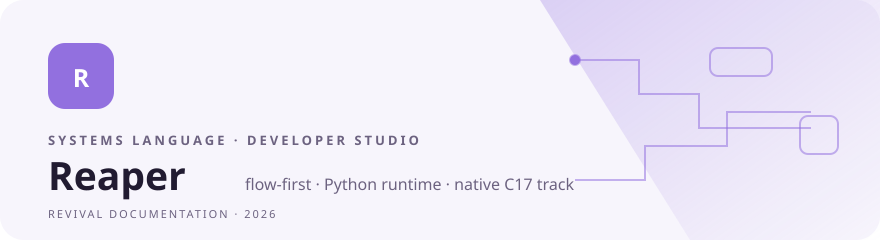
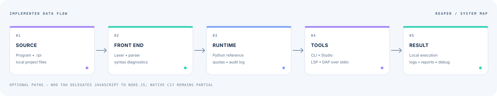

<picture><source media="(prefers-color-scheme: dark)" srcset="assets/readme/hero-banner-dark.svg"><source media="(prefers-color-scheme: light)" srcset="assets/readme/hero-banner-light.svg"></picture>

<h1 align="center">Reaper — системна мова програмування та середовище розробки</h1>

<strong>Flow-first мова з Python reference runtime, CLI, Windows Studio, локальними stdio LSP/DAP і окремою частковою native C17 гілкою.</strong>

  

[Швидкий старт](#швидкий-старт) · [Revival](#оновлення-документації-revival) · [Візуальний огляд](#візуальний-огляд) · [Архітектура](#архітектура) · [Документація](docs/README.md)

> **Межа реалізації:** Python runtime є виконуваною reference-реалізацією сумісності. Native C17 lexer/parser/IR/lowering реалізовані частково й не є повним компілятором або універсальним backend машинного коду. Studio працює лише у Windows. LSP/DAP — локальні stdio-сервіси, не hosted API.

## Швидкий старт

**Вимоги:** Python 3.10+, Git. Для Studio потрібен Tkinter. CMake 3.16+ і компілятор C17 потрібні лише для часткової native-гілки. Node.js для NOO TAH необов’язковий.

~~~sh
git clone https://github.com/Ivan-VHS/Reaper.git
cd Reaper
python -m venv .venv
# Windows PowerShell: .venv\Scripts\Activate.ps1
# Linux/macOS: source .venv/bin/activate
python -m pip install --upgrade pip
python -m pip install -e .
python -m reaper --check examples/flow.rpr
python -m reaper examples/flow.rpr
~~~

Запуск Windows Studio:

~~~sh
python reaper_desktop.py
~~~

Тестування:

~~~sh
python -m unittest discover -s tests -v
~~~

## Оновлення документації Revival

| Було | Стало |
|---|---|
| Один статичний банер | Парні SVG-банери для світлої й темної тем |
| Python runtime і native compiler було легко змішати | Чітко розділено Python reference і частковий native C17 |
| Знімок Studio змішувався зі схемою даних | Реальний знімок Windows Studio та окремо позначена схема |
| Загальні описи можливостей | Конкретні обмеження сервісів, платформ і language tooling |
| Довга навігація | Тематичні хаби, карта документації та стандарт публікації |

Це оновлення документації, **а не нова версія мови чи реліз Reaper**. Статуси звіряються з кодом, тестами та [FEATURES.md](docs/FEATURES.md).

## Поточна реалізація

| Компонент | Доступні можливості | Межа |
|---|---|---|
| Python reference runtime | Lexer, parser, interpreter, scopes, values, quotas, CLI/REPL | Еталонна реалізація сумісності |
| Статичний аналіз | Консервативні AST/type diagnostics у check, Studio і LSP | Не виконує вихідний код |
| Studio | Windows editor/debugger, command palette, MCU-профілі | Без live device inspector |
| LSP | stdio, UTF-16 positions, локальна діагностика, completion, hover, symbols | Лише відкритий документ; без міжфайлового type inference |
| DAP | Launch, line breakpoints, statement-boundary stepping, stack і locals | Лише документована частина runtime |
| Native C17 | Lexer, expression parser, owned AST, checked i64 IR, limited lowering | Частково; без повної паритетності мови |
| QCS / hardware contracts | Перевірка синтаксису та checked MMIO descriptor API | Без physical mapping і повного device runtime |
| NOO TAH | Необов’язкова інтеграція з офіційним Node.js | Node.js не потрібен для .rpr |

## Візуальний огляд

<table><tr><td width="50%">
<strong>Реальний знімок Studio</strong> — Windows desktop, 1920×1080.
</td><td width="50%">
<strong>Архітектурна ілюстрація</strong> — реалізований потік, не скриншот інтерфейсу.
</td></tr></table>

## Архітектура

~~~mermaid
flowchart LR
  A[.rpr source] --> B[Lexer і parser]
  B --> C[AST і source spans]
  C --> D[Python reference runtime]
  D --> E[CLI / REPL]
  D --> F[Windows Studio]
  D --> G[stdio LSP / DAP]
  C -. часткова гілка .-> H[Native C17 IR і limited lowering]
  I[Необов’язковий Node.js] --> J[NOO TAH adapter]
~~~

Native C17 показано як окрему часткову гілку; її не прирівняно до Python reference runtime.

## Конфігурація та довіра

Hosted web service, облікового запису або кореневого .env немає. Для NOO TAH доступні необов’язкові змінні шляхів:

| Змінна | Призначення |
|---|---|
| NOO_TAH_NODE | Явний шлях до Node executable |
| NOO_TAH_NPM_CLI | Явний шлях до npm-cli.js |
| NOO_TAH_NPX_CLI | Явний шлях до npx-cli.js |

Корисні прапорці: --check / --lint, --engine treewalk|vm, --allow-native-ffi та обмеження --steps, --items, --text-length, --heap-bytes, --open-resources. FFI вимкнено, доки користувач явно його не дозволить. Інтерпретатор не є OS sandbox; запускайте лише довірені програми й бібліотеки.

## Структура репозиторію

| Шлях | Призначення |
|---|---|
| reaper/ | Python frontend мови, runtime і command services |
| native/ / src/ | Часткова реалізація C17 та native contracts |
| examples/ | Виконувані програми .rpr |
| tests/ | Runtime, parser, diagnostics та integration-тести |
| editors/vscode/ | Лише синтаксична підтримка VS Code |
| docs/ | Контракти мови, compiler, runtime, IDE та hardware |
| assets/readme/ | Адаптивний банер і схема потоку |
| .github/workflows/ | Python CI, Windows Studio та інтеграції |

## Перевірки та дорожня карта

~~~sh
python -m unittest discover -s tests -v
python -m reaper --check examples/flow.rpr
git diff --check
~~~

Після змін native-гілки також запустіть CMake/CTest. Поточні етапи: [архітектура](docs/ARCHITECTURE.md), [матриця функцій](docs/FEATURES.md), [Hardware Language](docs/HARDWARE_LANGUAGE.md), [IDE contract](docs/REAPER_IDE.md) та [карта документації](docs/INFORMATION_ARCHITECTURE.md).

## Розробка

Див. [CONTRIBUTING.md](CONTRIBUTING.md), [README Visual Standard](docs/README_VISUAL_STANDARD.md) і [SECURITY.md](SECURITY.md). Зміни grammar, diagnostics, runtime quotas, LSP/DAP і native contracts мають супроводжуватися regression-тестами.

## Ліцензія

[Apache-2.0](LICENSE).
