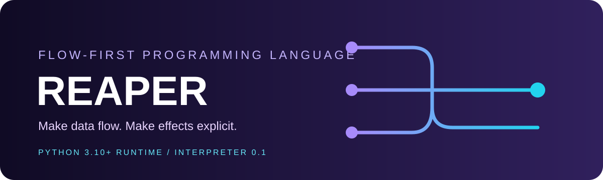
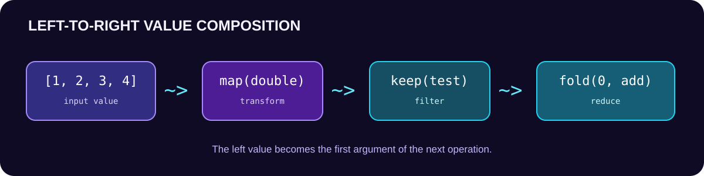
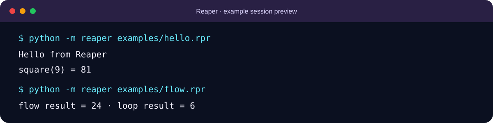
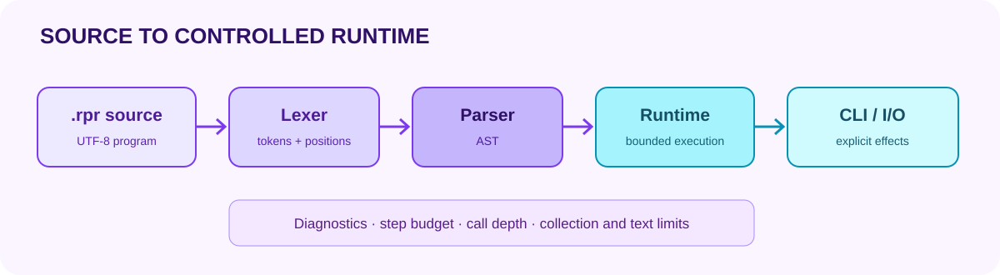

# Reaper
### 一门轻量、以数据流组合为核心的编程语言

<p align="center"></p>
<p align="center"><strong>清晰表达 · 组合数据流 · 显式管理副作用</strong><br>   </p>

**Reaper 是一门独立的、以数据流为先的编程语言。** 它让状态修改显式可见，并允许值通过可组合的转换步骤传递。0.1 版本是可执行的首个里程碑，包含词法分析器、语法分析器、树遍历解释器、CLI、示例、文档和测试。

[English](README.md) · [Українська](README.uk.md) · [Русский](README.ru.md) · [简体中文](README.zh-CN.md)

## 让数据流在代码中清晰可见

`~>` 运算符会把左侧的值作为第一个参数传给右侧操作。默认绑定不可变；状态修改必须明确表达。

<p align="center"></p>

```reaper
craft double(value) {
    yield value * 2
}

make numbers := [1, 2, 3, 4]
make answer := numbers ~> map(double) ~> sum()
emit "answer = " ++ text(answer)
```

## 运行 Reaper

环境要求：Python 3.10 或更高版本。解释器仅使用 Python 标准库。

```bash
git clone https://github.com/Ivan-VHS/Reaper.git
cd Reaper
python -m reaper examples/hello.rpr
python -m reaper examples/flow.rpr
python -m reaper --check examples/flow.rpr
```

本地安装命令：

```bash
python -m pip install -e .
reaper examples/hello.rpr
```

<p align="center"></p>
<sub>根据仓库示例制作的展示图，并非真实应用运行截图。</sub>

## 0.1 版本功能

- 带源码位置的词法分析器，支持 Unicode 标识符、注释和转义字符串。
- 递归下降语句解析器与 Pratt 表达式解析器。
- 不可变的 `make` 绑定；通过 `vary` 和 `change` 显式修改。
- 函数、词法闭包、递归和 `yield`。
- 列表、索引、算术、比较、布尔值及严格文本拼接。
- `when / otherwise`、`each` 和 `loop while`。
- 使用 `~>` 组合数据流，并提供 `map`、`keep`、`fold`、`sum` 等内置操作。
- 通过 `emit`、`say` 和 `ask` 显式执行控制台 I/O。
- 源码定位诊断与受限执行。
- 基于标准库的测试，以及面向 Python 3.10–3.12 的 GitHub Actions CI。

## 解释器架构

<p align="center"></p>

| 层 | 职责 |
|---|---|
| CLI | 参数解析、UTF-8 源码加载与仅检查模式 |
| 词法分析器 | 带源码位置的确定性 token |
| 语法分析器 | 递归下降语句解析与 Pratt 表达式解析 |
| Runtime | 词法环境、函数、内置操作与数据流组合 |
| 诊断 | 源码错误中的文件、行和列信息 |
| 测试与示例 | 可运行示例和语义回归测试 |
| 打包 | Python 包与 CLI 入口；无第三方运行时依赖 |

## 资源限制

默认限制：1,000,000 个执行步骤、256 层嵌套函数调用、100,000 个集合元素，以及文本拼接生成的 1,000,000 个字符。可通过 `--steps`、`--items` 和 `--text-length` 配置。

这些限制用于控制资源消耗，**并不是安全沙箱**。不要假设 Reaper 能将不可信程序与宿主进程隔离。

## 路线图

静态类型检查、效果类型、安全 FFI 边界、字节码/原生后端、结构化并发、语义图工具、包管理和自举编译器均属于未来阶段。只有在真实后端和一致性测试完成后，才会宣称支持 GPU 或分布式执行。

参阅[语言规范](LANGUAGE.md)、[架构文档](docs/ARCHITECTURE.md)、[AETHER-ANAS 路线图](docs/AETHER_ANAS_ROADMAP.md)、[示例](examples/)和[测试](tests/)。

## 许可证

Apache License 2.0，详见 [LICENSE](LICENSE)。
