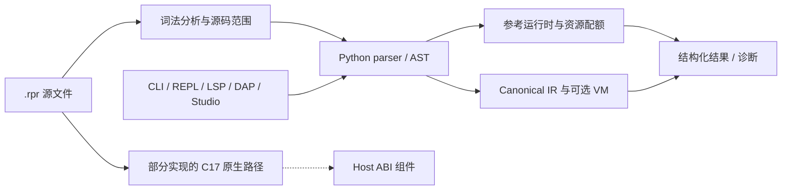

# Reaper — 流程优先的系统编程语言

[English](README.md) · [Українська](README.uk.md) · [Русский](README.ru.md) · [简体中文](README.zh-CN.md)

> 面向系统与硬件相关编程的 `.rpr` 流程语言、参考运行时，以及正在开发的 C17 原生编译器和工具链。

**规格**

| 字段 | 当前记录 |
|---|---|
| 仓库 | [Ivan-VHS/Reaper](https://github.com/Ivan-VHS/Reaper) |
| 产品状态 | Alpha / 持续开发；包含多条实现路径 |
| 产品版本 | 尚未声明统一的产品发布版本 |
| Python 包 | `reaper-lang 0.1.0`，Python 3.10+ |
| 原生路径 | C17 / CMake 3.16+；编译器和 host ABI 部分实现 |
| 运行平台 | Windows、Linux、macOS（参考运行时） |
| 桌面平台 | Windows Studio |
| 许可证 | [Apache-2.0](LICENSE) |
| 行为准则 | 尚未发布根目录 `CODE_OF_CONDUCT.md` |
| 文档审核日期 | 2026-11-26 |

<picture><source media="(prefers-color-scheme: dark)" srcset="assets/readme/dashboard.svg"></picture>

## 目录

- [用途与范围](#用途与范围)
- [架构](#架构与执行流程)
- [快速开始](#快速开始)
- [C17 原生路径](#c17-原生路径)
- [接口与生态](#接口与生态)
- [限制与安全边界](#限制与安全边界)
- [文档与贡献](#文档与贡献)
- [版本与历史](#版本与历史)

## 用途与范围

Reaper 是一种流程优先的编程语言及开发工具链，强调显式数据流、受限执行、结构化诊断和系统编程实验。当前兼容性实现是 Python 参考运行时；独立的 C17 路径正在开发原生编译器和 ABI 组件，但尚未达到功能等价。

语言使用 `::` 运算符进行值组合，源文件扩展名为 `.rpr`。文件系统、进程、网络、时钟、shell 和原生库等副作用必须显式声明或 opt-in，不应成为普通表达式的隐式行为。

## 架构与执行流程



参考运行时是当前已实现语言行为的兼容性依据。C17 原生路径独立开发，只有通过一致性测试后才能替代参考实现。Studio 是 Windows 桌面应用；语言和 CLI 工具不依赖 Studio。

## 快速开始

需要 Python 3.10+；建议安装 Git。以 editable 模式安装：

```sh
python -m venv .venv
python -m pip install -e .
python -m reaper --check examples/flow.rpr
python -m reaper examples/flow.rpr
```

启动 REPL 或 Studio：

```sh
python -m reaper --repl
python reaper_desktop.py
```

运行参考运行时测试：

```sh
python -m unittest discover -s tests -v
```

CLI 选项和执行限制以命令行帮助及 [Runtime Platform](docs/RUNTIME_PLATFORM.md) 为准。

## C17 原生路径

需要 CMake 3.16+ 和 C17 编译器。

```sh
cmake -S . -B build -DCMAKE_BUILD_TYPE=Release -DREAPER_BUILD_TESTS=ON
cmake --build build --parallel
ctest --test-dir build --output-on-failure
```

原生路径包含 lexer/parser、Canonical IR、optimizer/lowering 以及经过测试的 ABI/工具链组件。这仍是部分编译器实现，不代表完整语言覆盖、通用机器码生成或 freestanding 内核编译能力。

## 接口与生态

| 接口 | 方向 / 用途 | 边界 |
|---|---|---|
| Pytyliki C ABI v1 | 可选原生指标调用 | 显式指定可信库路径；原生代码在进程内执行 |
| OPlague device snapshot v1 | 只读 JSON 导入与比较 | Snapshot 是证据，不是认证 |
| VentuSample pack v1/v2 | 基于文件的元数据检查 | 只读 manifest 元数据，不修改 WAV 资产 |
| DAK 集成 | 策略和契约关联 | Host/reference 契约不代表内核集成 |

参见 [Federated Integration](docs/FEDERATED_INTEGRATION.md)、[System Runtime ABI v1](docs/SYSTEM_RUNTIME_ABI_V1.md) 和 [NEXUS federation profile](docs/NEXUS_FEDERATION_PROFILE_V1.md)。各关联项目拥有独立的许可证和发布周期。

## 限制与安全边界

> 执行配额是资源限制，不是针对任意不可信程序的安全沙箱。

Python 参考运行时仍是默认兼容实现。C17 原生实现尚不完整；自举路径只覆盖经过测试的前端子集，不是完整自举编译器。静态类型分析采用保守策略，模块和 host 边界的未知值仍可能保持未知。MMIO C API 通过宿主提供的适配器检查描述符和 capability；它本身不会映射物理内存或控制硬件。

Native FFI 会在当前进程中执行可信原生代码。只能加载显式选定且 ABI 兼容的库。文件系统、进程、网络、时钟和 shell 效果都有明确边界。Embedded/hardware 文档也包含参考和模拟接口；这不表示支持刷写固件或实时硬件调试。

Python 包版本和 CMake 项目版本属于不同交付物。Reaper 尚未声明统一产品发行版本。

## 文档与贡献

从[文档索引](docs/README.md)和[信息架构图](docs/INFORMATION_ARCHITECTURE.md)开始。

- [功能矩阵](docs/FEATURES.md)
- [架构](docs/ARCHITECTURE.md)
- [运行平台与配额](docs/RUNTIME_PLATFORM.md)
- [原生编译器](docs/NATIVE_COMPILER.md)
- [硬件语言](docs/HARDWARE_LANGUAGE.md)
- [Studio 与 IDE](docs/REAPER_IDE.md)
- [诊断](docs/errors/DIAGNOSTICS.md)
- [共享文档标准](docs/UNIFIED_DOCUMENTATION_STANDARD.md)

修改语法、运行时或公开契约前，请阅读 [CONTRIBUTING.md](CONTRIBUTING.md)。漏洞报告遵循 [SECURITY.md](SECURITY.md)。项目采用 [Apache-2.0](LICENSE)；请保留第三方归属和许可证声明。

## 版本与历史

Python 发行包当前声明版本 `0.1.0`，原生 CMake 项目声明版本 `0.2.0`。这两个版本对应不同交付组件，并非统一语言版本。项目仍处于 alpha 阶段。发布历史和兼容性变化应引用真实 Git 标签、发布制品和迁移文档；包版本本身不能证明 API 已稳定。
