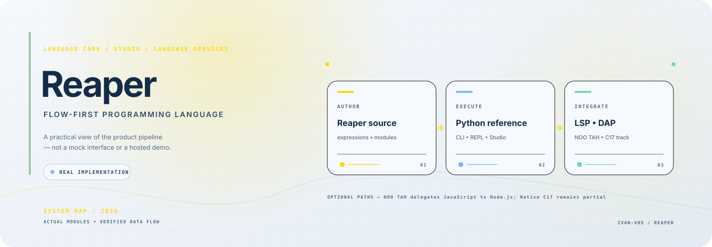

# Reaper

Reaper 是一款面向嵌入式软件、编译器工具、硬件相关程序和流式组合语言探索的系统编程语言与本地开发工作台。

[English](README.md) · [Українська](README.uk.md) · [Русский](README.ru.md) · [简体中文](README.zh-CN.md)

<picture>
  <source media="(prefers-color-scheme: dark)" srcset="assets/readme/dashboard.svg">
  
</picture>

  

[快速开始](#快速开始) · [截图](#截图) · [架构](#架构) · [路线图](#路线图) · [文档](docs/README.md) · [提交记录](https://github.com/Ivan-VHS/Reaper/commits/main)

> **状态：** 活跃开发。仓库提供 Python 参考运行时、CLI/REPL、Windows Studio 基础、stdio LSP/DAP 服务和部分原生 C17 实现。原生编译器能力尚未与参考运行时完全一致，特权硬件服务尚未完成。
>
> **平台：** Python 测试覆盖 3.10–3.12。可选 Node.js 兼容工作流测试 Node 22/24，覆盖 Windows、Linux 和 macOS。Windows Studio 需要 Tkinter。原生 C17 路径需要 CMake 3.16+ 和 C17 编译器。

### Jora 应用工厂

[DuckOS Jora](https://github.com/Ivan-VHS/DuckOS) 正在作为 Jora 平台和应用商店集成。每个生成的应用都有独立的产品名称，名称中不得包含 Jora。系统将所选功能模块（例如文本编辑器、音频编辑器和翻译器）组合为独立产品，例如 Sonaris，然后生成 Reaper 项目脚手架和 EN/RU/UK/MOST 界面字典。名称候选由应用功能决定，不会复用平台品牌。图结构可针对均衡性、延迟、模块化、可扩展性或最低复杂度进行优化，并导出为 JSON 和 Mermaid。详情请参阅：[Jora 应用工厂](docs/JORA_APPLICATION_FACTORY.md)。当前功能包仍是规格说明，而不是可运行的编辑器；生成的项目会经过静态检查，但尚不可安装。在此版本中，Reaper 是唯一已集成的源代码生成器，其他编译器适配器仍待实现。

## 快速开始

创建虚拟环境并安装 Python 参考运行时：

~~~sh
python -m venv .venv
python -m pip install --upgrade pip
python -m pip install -e .
python -m reaper --check examples/flow.rpr
python -m reaper examples/flow.rpr
~~~

启动 Studio 或交互式 REPL：

~~~sh
python reaper_desktop.py
python -m reaper --repl
~~~

运行测试：

~~~sh
python -m compileall -q reaper tests
python -m unittest discover -s tests -v
~~~

## 功能

| 组件 | 当前行为 | 边界 |
|---|---|---|
| Python 参考运行时 | Lexer、parser、interpreter、模块、闭包、资源配额和审计日志 | 当前可执行语言实现 |
| 静态检查 | 基础类型推断以及运算符、索引、可变性和调用参数数量诊断 | 部分类型系统 |
| Reaper Studio | Windows IDE 基础：项目树、编辑器、调试器和系统概览 | 本地 GUI，不是实时设备控制台 |
| LSP | stdio JSON-RPC 诊断、补全、悬停、符号和词法导航/格式化 | 仅针对打开的文档，不做跨文件语义推断 |
| DAP | 行断点、单步、调用栈和局部变量 | 语句边界调试子集 |
| NOO TAH | 与官方 Node.js、npm/npx 和 Inspector 的进程集成 | JavaScript 由上游 Node 执行 |
| 原生 C17 路径 | Lexer/parser、AST、检查过的 i64 IR 和有限 lowering | 实验性部分实现 |
| QCS 与嵌入式工具 | 硬件描述解析、AST/诊断和有界参考工具 | 分析用途，不访问物理硬件 |

目录中的条目或预留能力名称不代表运行时功能已实现。成熟度和边界见 [Features](docs/FEATURES.md)、[Hardware Language](docs/HARDWARE_LANGUAGE.md)、[Reaper IDE](docs/REAPER_IDE.md)、[NOO TAH](docs/NOO_TAH.md) 与 [Kora](docs/KORA.md)。

## Reaper 的特点

- `.rpr` Python 参考运行时目前可执行；原生编译器明确作为部分实现分支。
- CLI、Studio、语言服务和测试共享同一语言实现。
- 资源配额和可选 hash-chained 审计日志让执行边界可检查。
- 硬件能力以可验证契约和适配器表达，不宣称拥有特权设备访问。
- NOO TAH 调用上游 Node，不宣称重新实现 V8 或 libuv。

## 截图

<picture>
  <source media="(prefers-color-scheme: dark)" srcset="assets/readme/workflow-dark.svg">
  
</picture>

  

由仓库截图工作流捕获的 1920×1080 Windows Studio 真实截图。上方 SVG 是架构图。

## 架构

~~~mermaid
flowchart LR
    A[.rpr source] --> B[Lexer and parser]
    B --> C[Python reference runtime]
    C --> D[CLI / REPL]
    C --> E[Studio]
    C --> F[LSP / DAP]
    G[Partial native C17] -. separate track .-> B
    H[JavaScript project] --> I[NOO TAH]
    I --> J[Official Node.js]
~~~

| 路径 | 职责 |
|---|---|
| `reaper/` | Python runtime、CLI、Studio、语言/调试服务与 NOO TAH |
| `reaper/kora/` | Kora 标准库辅助工具 |
| `src/`、`include/` | 部分原生 C17 实现 |
| `tests/`、`examples/` | runtime/protocol 测试和本地 `.rpr` 示例 |
| `docs/`、`editors/` | 语言、IDE、架构和编辑器支持 |
| `.github/workflows/` | CI、native/desktop build、截图和 Node 兼容测试 |

## 构建矩阵

| 目标 | 要求 | 状态 |
|---|---|---|
| Python 参考运行时 | Python 3.10+ | 可执行；CI 测试 3.10/3.11/3.12 |
| Windows Studio | 带 Tkinter 的 Python | Desktop workflow 目标 |
| 原生 C17 子集 | CMake 3.16+、C17 编译器 | 部分实现，单独测试 |
| NOO TAH | 当前 CI 测试 Node.js 22/24 | 可选集成 |
| macOS | Python 路径 / Node 兼容作业 | 不代表原生 Studio 支持 |

## README Revival 更新

- 首页区分可执行的 Python 参考运行时与部分原生编译器。
- 安装、检查、运行和测试命令前置。
- 真实 Windows Studio 截图与可编辑图示分开。
- 明确说明 LSP、DAP、硬件适配器和 Node 集成的边界。

| 旧版阅读方式 | 更新后 |
|---|---|
| 泛化的语言平台描述 | 功能和成熟度表 |
| 原生编译器状态易被误读 | 参考实现与部分实现分离 |
| 需要翻找启动命令 | 首页提供可复制命令 |
| 对 IDE 能力笼统描述 | 明确按打开文档划分语言服务范围 |

## 路线图

- [x] Python runtime、CLI/REPL 和本地示例。
- [x] stdio LSP/DAP 基础服务与 Windows Studio 基础。
- [x] 部分原生 C17 lexer/parser/IR 和测试目标。
- [ ] 与测试同步扩展 native type/ownership/effect 分析和代码生成。
- [ ] 仅通过经过审查的平台适配器与专项验证添加 OS-backed MMIO/IRQ/DMA。

## 生态

- [DuckOS](https://github.com/Ivan-VHS/DuckOS) — 操作系统项目与 Mora 工作区。
- [Pytyliki](https://github.com/Ivan-VHS/Pytyliki) — 处理器检查和有界系统工具。
- [OPlague](https://github.com/Ivan-VHS/OPlague) — 设备与驱动证据工作台。
- [VentuSample](https://github.com/Ivan-VHS/VentuSample) — 程序化采样与离线 DSP。

参阅[文档索引](docs/README.md)、[架构](docs/ARCHITECTURE.md)、[贡献指南](CONTRIBUTING.md)和 [VS Code 语法支持说明](editors/vscode/README.md)。许可证：[Apache-2.0](LICENSE)。
