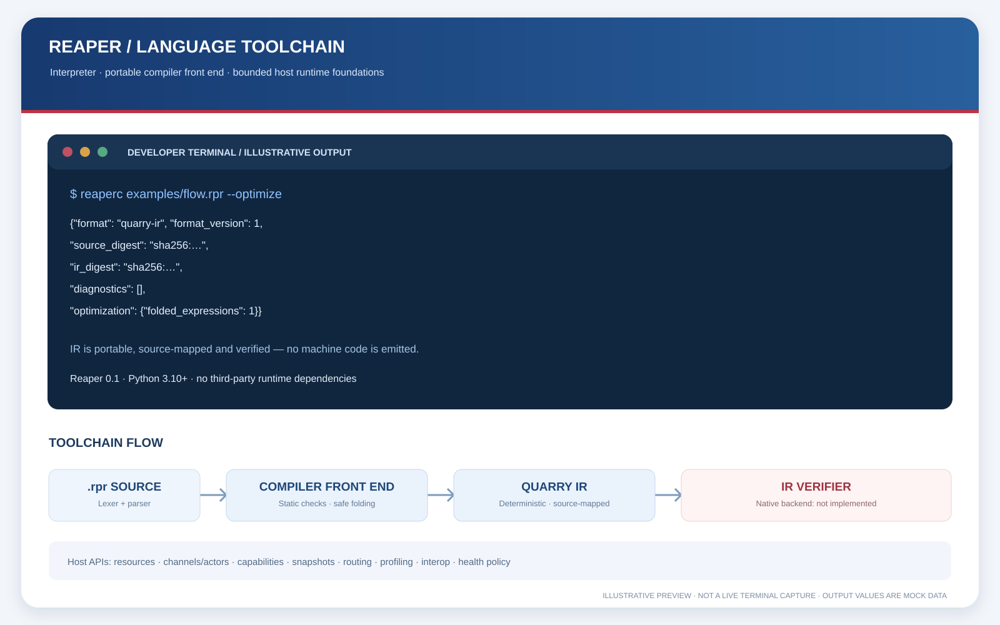
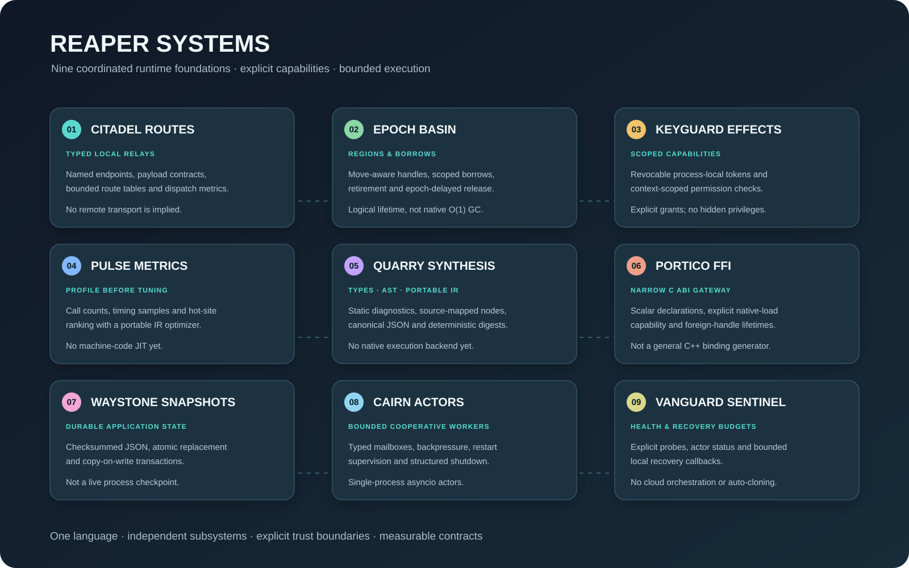

# Reaper — 面向数据流组合的编程语言

  
  
  
  

Reaper 是一门独立的、以数据流组合为核心的编程语言，具有易读语法和有界解释器。工程代码树还包含可移植编译器前端、可选宿主运行时 API 和实验性的 native C17 工作流。解释器仍然是语义参考实现。

**语言：** [English](README.md) · [Русский](README.ru.md) · [Українська](README.uk.md) · 简体中文

## 视觉预览

这些图片是依据源码制作的 SVG 预览和架构图，并非真实终端会话的屏幕截图。预览中的终端文本和示例数值仅用于说明。

## 语言与运行时

- **数据流语法：** 保留现有 ~> 操作符组合转换，不改变 Reaper 语法。
- **解释器：** lexer、parser、AST 和有界树遍历执行仍是兼容性基准。
- **编译器前端：** 保守静态诊断、带源码位置映射的确定性 Quarry IR、结构验证和安全字面量折叠。前端不会生成 native 机器码。
- **宿主运行时 API：** 有界资源区域、异步 channel/actor、作用域 capability、带校验和的应用状态快照、本地路由、性能分析、受 capability 控制的 C ABI 互操作及健康策略观察。
- **宿主平台报告：** --target-info 报告宿主元数据，包括 E2K 识别；这不代表已实现 MCST native 后端。
- **Native C17 工作流：** 可移植编译器/运行时基础及测试与 Python 解释器分开维护；不宣称完整语言功能一致性。

## 运行仓库示例

要求 Python 3.10 或更高版本。运行时仅依赖 Python 标准库。

    git clone https://github.com/Ivan-VHS/Reaper.git
    cd Reaper
    python -m reaper --check examples/flow.rpr
    python -m reaper examples/flow.rpr
    python -m reaper --target-info
    python -m reaper.compiler_cli examples/flow.rpr --optimize

## 构建与验证

运行 Python 测试：

    python -m compileall -q reaper tests
    python -m unittest discover -s tests -v

构建并测试 native C17 目标：

    cmake -S . -B build -DBUILD_TESTING=ON
    cmake --build build --parallel
    ctest --test-dir build --output-on-failure

GitHub Actions 验证 Python 3.10、3.11 和 3.12，运行解释器示例，检查编译器 CLI 和运行时架构示例，并测试 native C17 目标。独立 HMGA 审计工作流检查仓库工程契约。

## 集成的工程更新

集成分支从现有开发历史中精选兼容改动：

- **编译器前端：** 源码映射 Quarry IR、确定性摘要、保守静态检查、结构验证和安全常量折叠。
- **运行时基础：** 有界资源、异步 channel/actor、宿主 capability 作用域、持久化应用状态快照、本地路由、性能分析、受限 C ABI 互操作和健康策略。
- **E2K 配置：** 仅报告宿主识别和能力；尚未实现 MCST native 代码生成。
- **MOST 架构：** 将分阶段系统设计映射到现有语言和 C17 迁移，不改变 Reaper 语法。
- **HMGA v2/v3：** 只读仓库审计，以及 native C17 确定性目录：20 条公理、400 个操作符，最多 64 轮规划。
- **工程门禁：** 按签名验证组合、多个 Python 版本检查、native C17 测试和有据可查的 review/merge 流程。

历史上 actor、effect、resource、relay 和 health API 的重叠原型经过审查并去重，没有并排安装成竞争实现。当前按模块划分的 host-runtime 实现仍是规范路径。详细记录见[集成审计](docs/INTEGRATION_AUDIT_2026-11-19.md)。

## 架构与文档

- [语言参考](LANGUAGE.md)
- [平台架构](docs/PLATFORM_ARCHITECTURE.md)
- [九个运行时系统](docs/REAPER_SYSTEMS.md)
- [循环运行时架构](docs/REAPERS_ARCHITECTURE.md)
- [MOST 系统架构](docs/MOST_SYSTEMS_ARCHITECTURE.md)
- [工程标准](docs/ENGINEERING_STANDARD.md)
- [HMGA v2.0 契约](docs/HMGA_V2.0.md)
- [HMGA v3.0 操作矩阵](docs/HMGA_V3.md)
- [E2K 宿主配置](docs/ELBRUS_E2K.md)
- [集成审计](docs/INTEGRATION_AUDIT_2026-11-19.md)

## 当前边界

Reaper 0.1 仍以解释器为核心。编译器前端生成可移植 IR，而非机器码。宿主 API 通过 Python 显式启用，不会自动成为语言内置功能或操作系统沙箱。当前不宣称 native 代码生成、JIT、分布式 actor、网络传输、云编排或完整的 MCST E2K 支持。

## 许可证

项目采用 [Apache License 2.0](LICENSE)。
