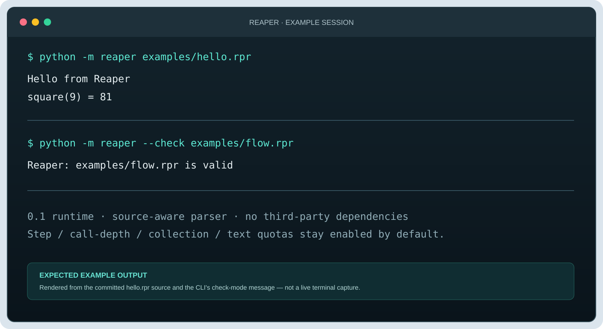

# Reaper — 面向数据流组合的编程语言

<p align="center">
  
  
  
  
  <a href="https://github.com/Ivan-VHS/Reaper/actions/workflows/ci.yml"></a>
</p>

<p align="center"><strong>清晰表达 · 组合数据流 · 显式声明副作用</strong></p>

<p align="center"></p>

**Reaper 是一门独立的表达式导向编程语言，强调可读语法与显式数据流。** 核心运算符 `~>` 将一个值传递给下一步操作，让转换链像流程一样从左向右阅读，而不是隐藏在层层嵌套的调用中。

**0.1.0** 是首个可执行里程碑：包含词法分析器、语法分析器、运行时、命令行工具、示例和测试的 Python 3.10+ 树遍历解释器。运行时仅使用 Python 标准库。

**语言：** [English](README.md) · [Русский](README.ru.md) · [Українська](README.uk.md) · 简体中文

## 一眼读懂 Reaper

```reaper
craft double(value) {
    yield value * 2
}

make numbers := [1, 2, 3, 4]
make answer := numbers ~> map(double) ~> sum()
emit "answer = " ++ text(answer)
```

流运算符将左侧的值作为右侧操作的第一个参数。`make` 创建不可变绑定；`vary` 声明可变绑定；`change` 执行重新赋值。

## 0.1 已实现的功能

| 语言能力 | 当前实现 |
|---|---|
| **清晰的源代码** | Unicode 标识符、注释和转义文本字面量 |
| **函数** | `craft`、词法闭包、递归和 `yield` |
| **显式状态** | 不可变的 `make`；通过 `vary` 与显式 `change` 管理可变状态 |
| **控制流** | `when / otherwise`、`each` 和 `loop while` |
| **数据流** | `~>` 组合，以及 `map`、`keep`、`fold` 等内置操作 |
| **诊断** | 保留源代码位置的词法、语法和运行时错误 |
| **执行限制** | 步骤预算、调用深度、集合元素数量和文本长度限制 |
| **开发工具** | CLI、仅检查模式、示例和标准库测试 |

## 运行仓库内的示例

<p align="center"></p>

<sub>终端示意预览。图中内容对应仓库示例和 CLI 检查模式的预期输出；这不是从实际终端截取的屏幕截图。</sub>

### 环境要求

- Python 3.10 或更新版本
- 无需第三方运行时依赖

### 从仓库运行

```bash
git clone https://github.com/Ivan-VHS/Reaper.git
cd Reaper

python -m reaper examples/hello.rpr
python -m reaper examples/flow.rpr
python -m reaper --check examples/flow.rpr
```

以可编辑模式安装命令行入口：

```bash
python -m pip install -e .
reaper examples/hello.rpr
```

运行完整测试套件：

```bash
python -m unittest discover -s tests -v
```

## Reaper 如何执行程序

<p align="center"></p>

源代码经过词法分析生成 token，再由语法分析器生成 AST，最后交给受限的树遍历解释器执行。控制台交互必须通过 `emit`、`say` 和 `ask` 等语言操作显式表达。普通表达式不会隐式获得文件系统、网络、时钟、进程、shell 或硬件访问能力。

## 小巧核心，规则清晰

- **默认不可变：** 使用 `make` 创建固定绑定；通过 `vary` 和 `change` 明确选择可变状态。
- **从左到右组合：** `values ~> map(double) ~> keep(is_large)` 直接展示数据路径。
- **显式转换：** 算术针对数值；`++` 只连接文本。使用 `text()` 或 `number()` 明确转换，避免隐式类型转换。
- **受限执行：** 默认上限为 1,000,000 个执行步骤、256 层嵌套函数调用、100,000 个集合元素，以及 1,000,000 个文本拼接字符。
- **可定位的错误：** 在源 token 可用时，诊断会保留源代码位置。
- **可移植实现：** 当前解释器支持 Python 3.10+，仅依赖标准库。

> [!NOTE]
> 这些限制用于约束资源消耗，并不是安全沙箱。不要假设解释器能够将不可信程序与宿主进程隔离。

## 文档与工程计划

- [语言参考](LANGUAGE.md) — 语法、表达式、内置操作和运行时限制。
- [架构](docs/ARCHITECTURE.md) — 实现层次与项目边界。
- [架构要求](docs/ARCHITECTURE_66.md) — 可验证的模块化和安全要求。
- [AETHER-ANAS 路线图](docs/AETHER_ANAS_ROADMAP.md) — 分阶段集成计划与验收门槛。
- [20 项系统工程计划](docs/20_SYSTEM_ENHANCEMENTS.md) — 工程契约与验收重点。
- [宪章配置](docs/CONSTITUTION_666_PROFILE.md) — 项目规则与符合性状态。
- [可运行示例](examples/) 和 [测试](tests/)。

20 项工程方向是**工程契约与规划工作**，并不代表 20 个运行时子系统已经全部实现。静态类型检查、显式效果类型、原生编译、GPU 执行、分布式调度、包管理、形式化验证和自举编译器均属于未来里程碑。只有在真实后端和一致性测试完成后，才会将其标记为已实现。

## CI 与当前边界

GitHub Actions 在 Python **3.10、3.11 和 3.12** 上运行验证。工作流会编译包和测试、执行单元测试、在不运行程序的情况下检查示例，并运行数据流示例。

Reaper 0.1 是解释器，**不是**原生代码编译器、操作系统、包注册中心、插件宿主或自主代理。资源配额不等于隔离机制。

## 许可证

Reaper 根据 [Apache 许可证 2.0](LICENSE) 发布。
