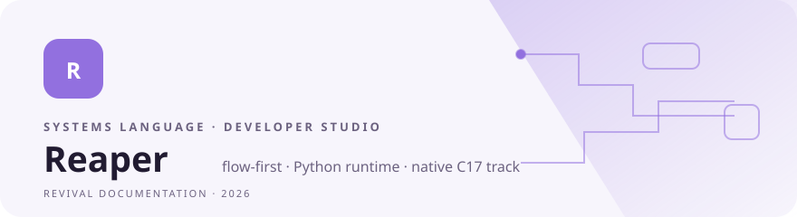

<picture><source media="(prefers-color-scheme: dark)" srcset="../../assets/readme/hero-banner-dark.svg"><source media="(prefers-color-scheme: light)" srcset="../../assets/readme/hero-banner-light.svg"></picture>

# Reaper / МОСТ — VS Code syntax support

This folder contains the syntax-only VS Code language package for .rpr and .most files: language registration, bracket matching, comments, strings, indentation and TextMate syntax coloring.

## What this package does not include

- No packaged LSP client or automatic LSP activation.
- No semantic completion, cross-file type inference, AST/IR refactoring or project indexing.
- No DAP client, debugger UI, profiler UI or native compiler integration.
- No additional runtime, grammar implementation or hardware permissions.

## Optional Reaper language services

The main Reaper repository provides local stdio services, which are separate runtime processes and are not activated by this syntax package:

~~~sh
python -m reaper lsp
python -m reaper dap
~~~

LSP capabilities and document-local limits are defined in the [Reaper IDE contract](../../docs/REAPER_IDE.md). DAP supports only the documented runtime subset.

## Validation

Keep TextMate grammar aligned with the canonical language contract. Test comments, strings, brackets, indentation and syntax highlighting in both light and dark editor themes. Do not use color as the only signal.

## Documentation

- [Main Reaper README](../../README.md)
- [Language and toolchain hub](../../docs/clusters/language-toolchain.md)
- [IDE architecture](../../docs/REAPER_IDE.md)
- [Contributing guide](../../CONTRIBUTING.md)
